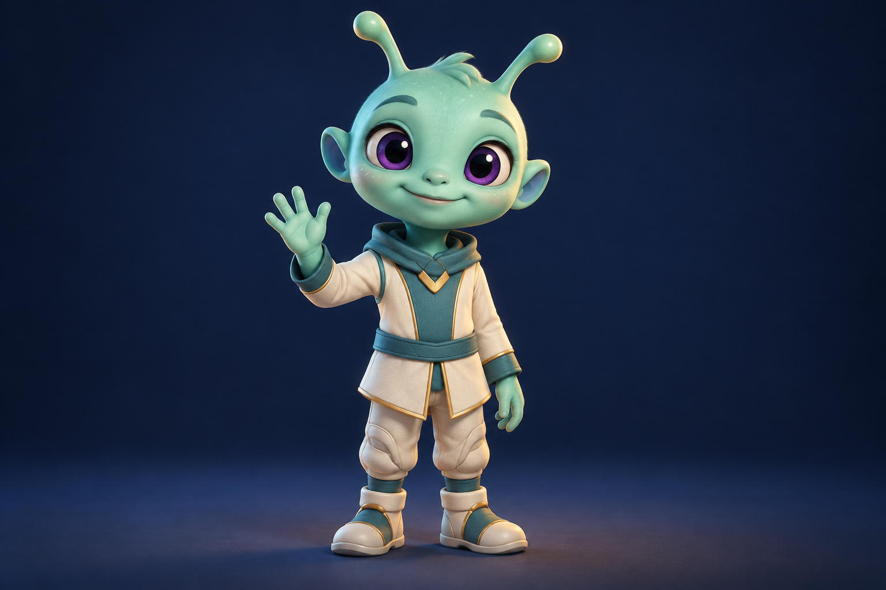

# 外星小朋友视觉参考 v1

2026-11-02｜《来自星星的礼物》｜内置 imagegen 工具生成。

本图为静态造型参考，不是已生成的视频关键帧。天体运动需另行制作；外星角色的投影、检测界面和中文字幕由后期添加。

## 最终生成提示词

Use case: stylized-concept. Single character visual reference for a FRIENDLY ALIEN CHILD who sends a gift to Earth children in a warm age-9 science adventure. Premium family animation 3D character, approachable and recognizably extraterrestrial: soft mint-teal skin, round cheeky face, two short rounded antennae, small rounded ears, large expressive dark violet eyes with clear bright highlights and friendly eyelids, tiny nose, gentle CLOSED-MOUTH smile. Childlike proportions, large head and small body, simple ivory and teal soft space tunic with subtle small gold trim, no helmet, no logos or markings. Exactly one character, medium full-body view showing both feet and antennae, facing camera, its RIGHT hand raised in an open relaxed wave, left hand resting down, five rounded fingers per hand, no gift held. Neutral dark navy studio background, ground shadow, soft warm key and cool fill, clear clean silhouette, tactile appealing materials, calm cheerful welcoming posture. Solid opaque character master for later compositing into a spaceship holographic projection: do NOT add transparency, scanlines, screen, projector, beams or UI in this reference. No text, no watermark, no collage, not a human child in makeup, not a scary gray alien. Landscape image with character centered and enough space around raised hand.
