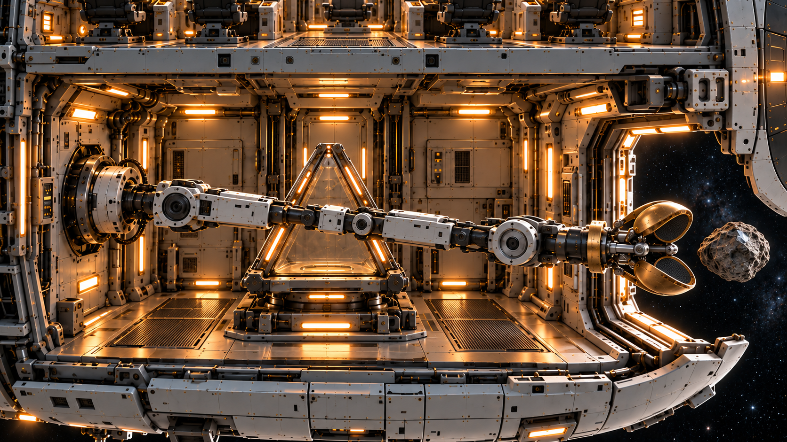
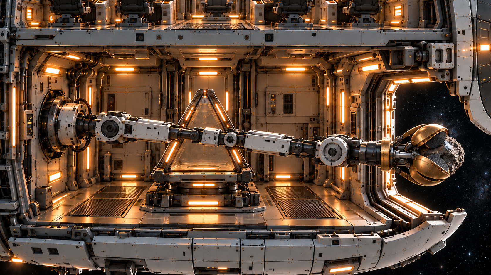

# 结构调整后的机械臂定妆照

2026-10-31。以下图片由内置imagegen制作，直接复制本轮已完成的结构一致版，未恢复用户已清理的旧机械臂图。

唯一空间母版：`../ship/echo_bridge_sampling_cutaway_v2.png`。机械臂基座固定在舰桥正下方封闭采样舱的左侧内壁，中央为三角回收舱与内部升降平台，右侧为外舱门。

## 伸出接近

石头在右侧舱外，回收舱为空。末端小臂、手腕与抓手轴向一致，五瓣杯口朝向前方石头；透视遮挡不改变五瓣完整结构。

## 抓取成功

同一机位、同一舱室。唯一实体石头被抓手夹持，回收舱仍为空。此图与伸出图仅动作状态不同。

## 动作要求

外舱门打开后伸臂，抓牢后携石收回同一下层舱，放入回收舱托座，抓手释放并收拢。回收舱盖和外舱门关闭后，舰桥地板打开，回收舱升入舰桥。手腕不自转、不偏折，肩肘关节负责位置调整，花瓣自身铰链负责合拢。

生成提示词及输入顺序见本目录prompts；静态图用作姿态和结构参考，动态仍需逐帧核对瓣数、接触和手腕姿态。
