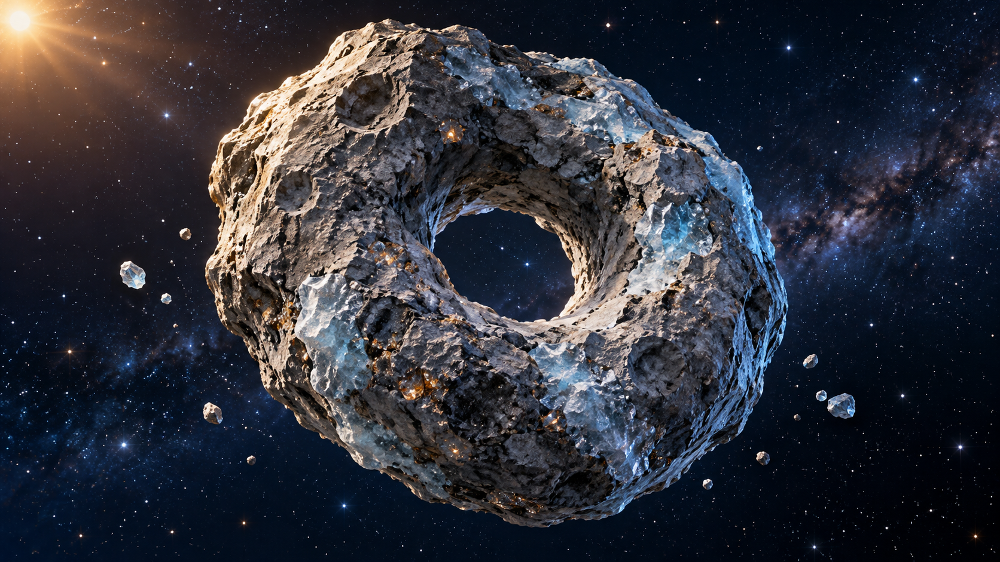

# 甜甜圈小行星视觉参考 v1

2026-11-02｜《来自星星的礼物》｜内置 imagegen 工具生成。

本图为静态造型参考，不是已生成的视频关键帧。天体运动需另行制作；外星角色的投影、检测界面和中文字幕由后期添加。

## 最终生成提示词

Use case: stylized-concept. Single visual reference for a delightful Kuiper Belt 'donut asteroid' in an age-9 children's cinematic space adventure. One irregular natural blue-gray rocky asteroid with a very clear large THROUGH HOLE, off-center slightly, unmistakable donut topology but NOT food, not a metal ring, no glaze. Thick weathered rocky walls with shallow craters, icy blue mineral patches and tiny amber mineral flecks, tactile stylized realistic 3D rendering matching a blue-gray meteorite gift prop. Three-quarter view so the dark starfield is clearly visible through the hole, whole object centered with generous negative space, horizontal 16:9-like composition. A few tiny loose ice fragments nearby for scale but no rings or duplicate asteroids. Dark navy starry background, warm side sunlight and cool blue rimlight, optimistic wonder, readable silhouette, no humans, no spacecraft, no face, no text, no labels, no watermarks.
