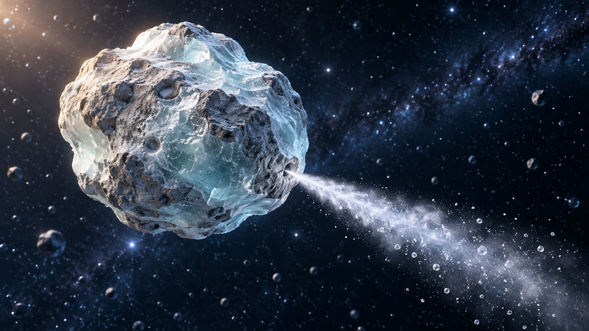

# 喷气冰石视觉参考 v1

2026-11-02｜《来自星星的礼物》｜内置 imagegen 工具生成。

本图为静态造型参考，不是已生成的视频关键帧。天体运动需另行制作；外星角色的投影、检测界面和中文字幕由后期添加。

## 最终生成提示词

Use case: stylized-concept. Single cinematic 3D visual reference of a 'gas-jet ice rock' for an age-9 space adventure set in the Kuiper Belt. One irregular rounded icy asteroid, pale frosted cyan ice mixed with rough blue-gray stone, shallow craters, partly translucent ice facets, no face. A small natural vent on its lower-right flank ejects ONE clear narrow white vapor plume with tiny sparkling ice particles toward the lower-right; its direction visibly suggests rock propelled opposite the jet. Vapor icy, not fire or rocket engine. Keep entire asteroid and almost entire tapering plume visible, centered-left with room for plume, dark navy starfield. Tactile stylized realism, premium family film 3D rendering, warm soft sunlight from upper left, blue cool rim light, same material world as blue-gray meteorite and ice ring asteroid. Readable clean silhouette, no humans, no spacecraft, no tech attached, no text, no arrows, no symbols, no collage, no watermark. Wide landscape composition.
