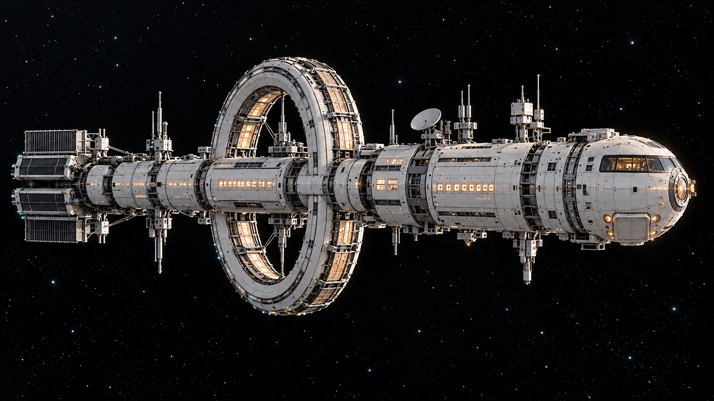
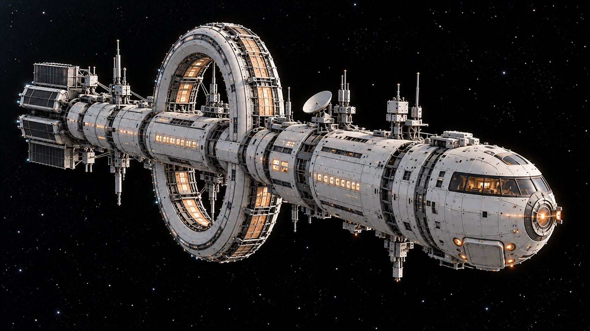
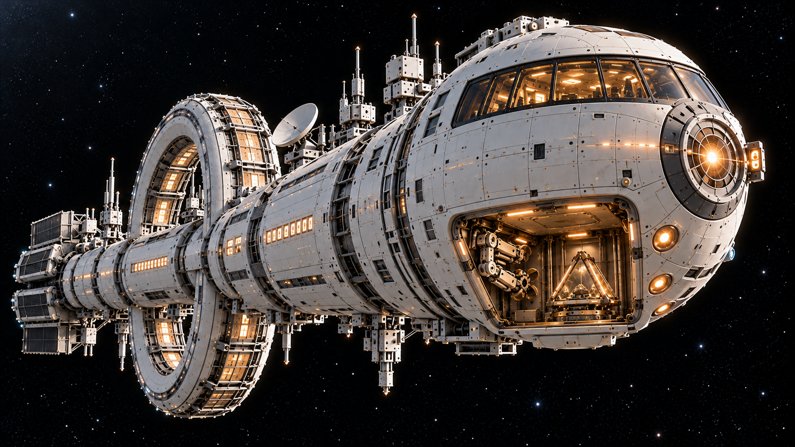
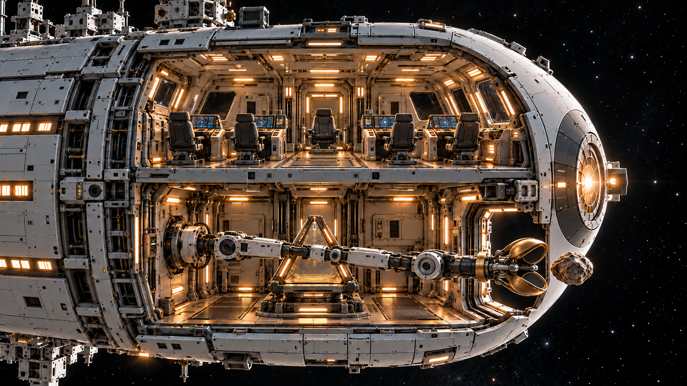

# 回声号新版定妆照 v2

2026-10-31。使用内置imagegen生成；提示词与参考顺序见 `prompts/`。原v1图片保留为历史素材。新版保持单个大环、长圆柱白灰船体、暖色舷窗、尾部散热阵列与天线；调整船首为上下两层。

## 当前外形与结构

上层为加宽舰桥，观察窗位于船首上半部。舰桥正下方、同一船首内部为一个封闭采样舱。机械臂与三角万花筒回收舱共同位于下层采样舱内。原舰桥后方的船体侧面机械臂开口取消。

外舱门打开→机械臂伸出→五瓣朝前夹住石头→携石收回下层舱内→放入回收舱并由托座接稳→抓手释放、机械臂收拢→回收舱关盖、外舱门关闭→舰桥地板打开→回收舱沿内部升降机构升入舰桥。

抓取时末端小臂、手腕与抓手中心轴保持同轴，手腕不偏折、不自转，花瓣自身铰链负责合拢。侧面图允许花瓣自然遮挡，完整结构仍要求五瓣。动态视频须用动作关键帧核对，静态效果图不证明全过程无转动。

## 侧视：关舱状态

## 前侧三分之四：关舱状态

## 前下方低角度：开舱状态

同一开口内可见收拢机械臂与三角回收舱。图中已在回收舱内的石头属于采样后、外舱门关闭前的状态，不是抓取前状态。室内天花板上的升降口通向舰桥地板。

## 上下层结构剖视

剖视图仅用于理解舱室与升降关系，正片不出现剖开的船壳。此图为抓取前：舱外唯一石头，回收舱托座为空。

## 舰桥内升舱效果

[查看加宽舰桥、面向操作者的屏幕与地板升降效果](../../视频/90秒故事版/视觉标准/结构调整_舰桥下方采样区/C_加宽舰桥地板打开回收舱上升_v2.png)

这组图用于外观和空间方向确认，非工程尺寸图。后续逐镜以同一角度起止帧锁定窗框、舱门、关节和升降口尺寸；不能混入v1侧面机械臂布局。

## 采样区统一母版

本目录 `echo_bridge_sampling_cutaway_v2.png` 是采样区唯一空间结构母版。[采样区A-v3/B-v3及对照说明](../../视频/90秒故事版/视觉标准/结构调整_舰桥下方采样区/调整说明.md)已按此图重绘。原外置框架布局与旧背景停用。

机械臂结构调整后的伸出与抓取定妆照已保存至项目目录 `定妆照/arm/`，文件为 `extended_same_compartment_v3.png`、`grasp_same_compartment_v3.png`。
