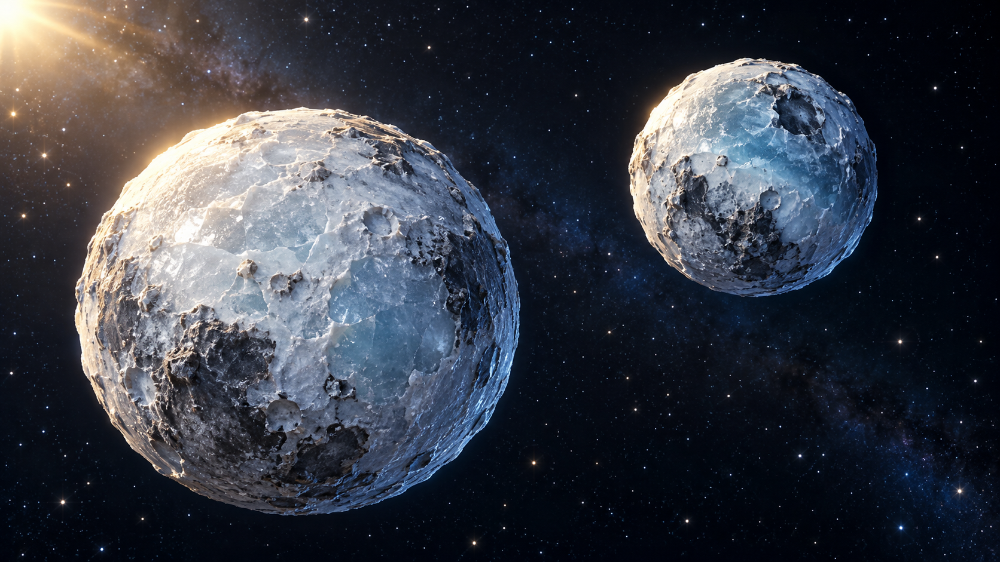

# 双胞胎冰球视觉参考 v1

2026-11-02｜《来自星星的礼物》｜内置 imagegen 工具生成。

本图为静态造型参考，不是已生成的视频关键帧。天体运动需另行制作；外星角色的投影、检测界面和中文字幕由后期添加。

## 最终生成提示词

Use case: stylized-concept. One cinematic 3D visual reference scene of 'twin ice balls' as a mutually orbiting pair of small Kuiper Belt bodies, for age-9 children's space film. Exactly TWO rounded natural icy bodies, one slightly bigger at left below, smaller at right above, clearly separated by a gap of approximately half the large body's diameter, both fully visible. Pale cyan-white frosted surfaces, blue-gray rocky patches, shallow craters and gently translucent ice, subtly distinct textures to identify each during motion. They look like a companion pair, not planets with faces. Diagonal balanced composition with empty dark space between and around them, dark navy starfield, warm sunlight upper left and cool blue rim light. Premium family film stylized realistic 3D, tactile believable ice and rock, visually consistent with gray icy donut asteroid and gas-jet icy stone. No faces, no eyes, no arms or holding hands, no extra moons, no orbital trail graphics, no arrows, no text, no spacecraft, no collage, no watermark. Wide landscape image.
