<!-- p01 -->

# 去看一眼

**柯伊伯带 · 采样日志**

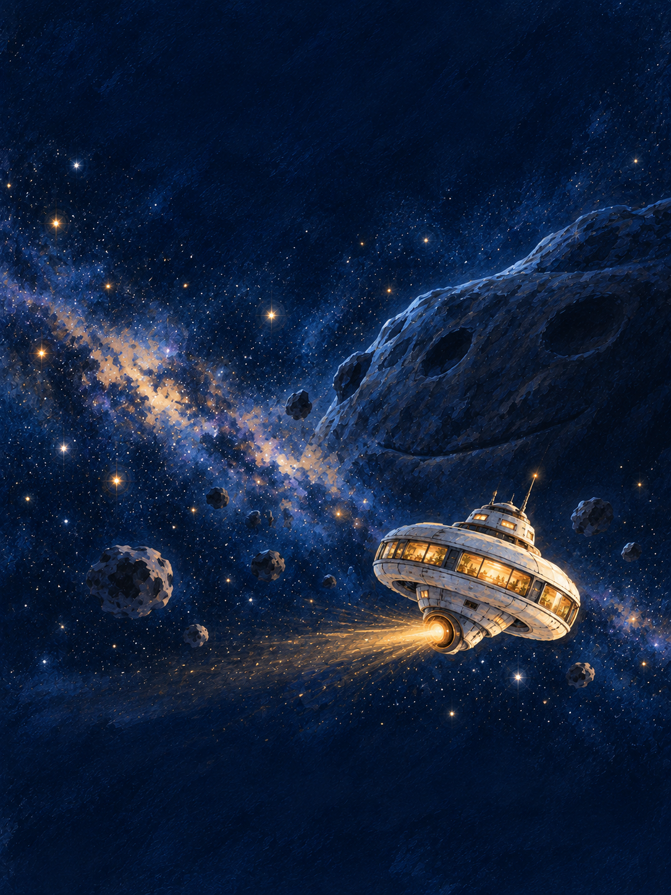

我们飞了十二年，只为去看一眼。

---

<!-- p02 -->

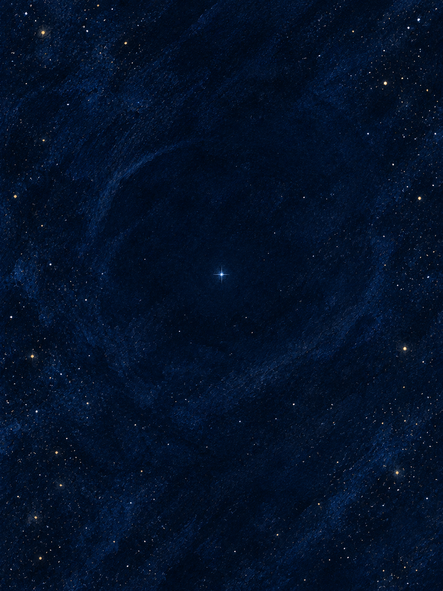

---

<!-- p03 -->

## 去看一眼

柯伊伯带 · 采样日志

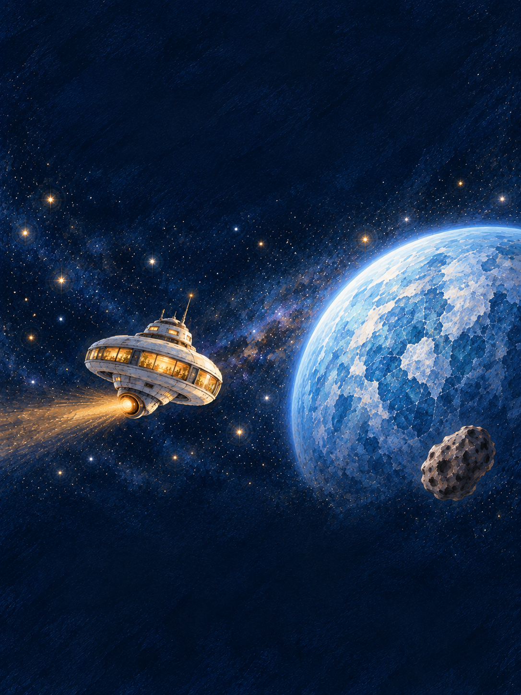

给每一个想去远方看一眼的人。  
也献给那颗还在原地、睁着眼睛的石头。

---

<!-- p04 -->

## 04 · 五名船员

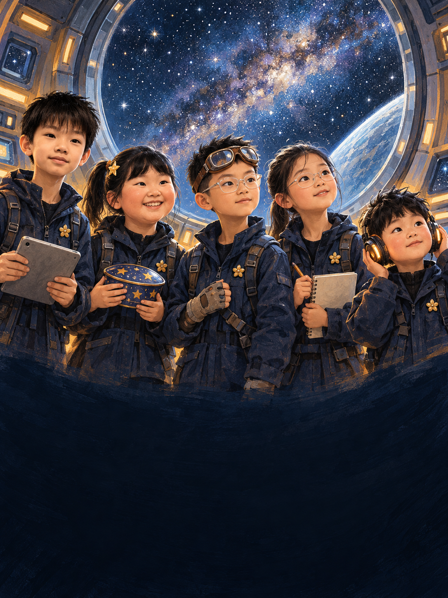

张铭轩 · 指令长  
张楚珺 · 驾驶员  
汤兴昊 · 机械臂手  
赵以清 · 科学官  
王一初 · 通讯员

---

<!-- p05 -->

## 05 · 黑暗里的眨眼

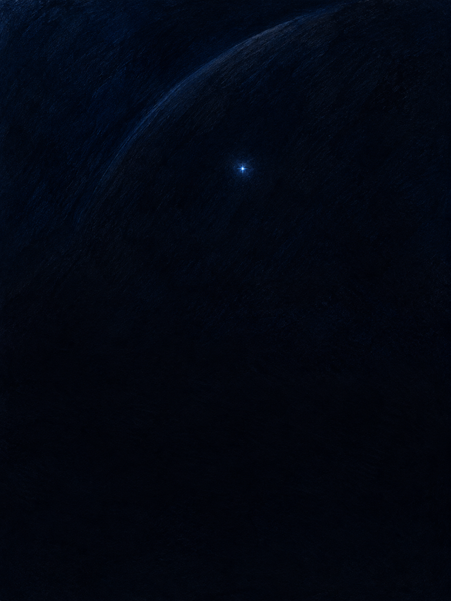

在太阳系的尽头，黑暗像一床很厚很厚的被子。

这里离太阳六十五亿公里。冷到零下二百三十三度。连光走到这里，都变得有气无力。

时间在这里走得很慢。慢到一块石头，可以转上四十六亿年。

可是，每过十六个小时，黑暗里就会有一道光，眨一下。

眨——

像一只藏在被子里的眼睛。

---

<!-- p06 -->

## 06 · 地球上的人

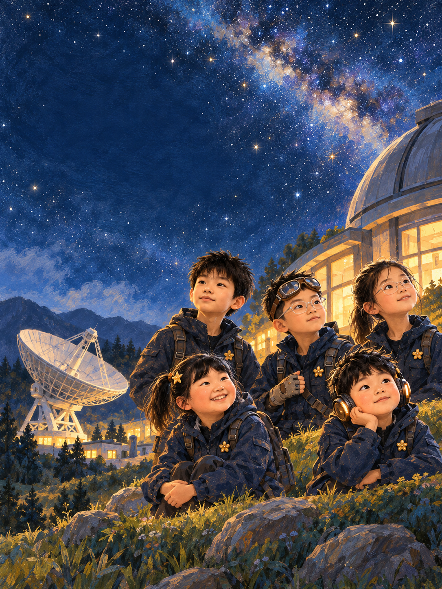

地球上的人看见了。

有人说是星星在闪。有人说是宇宙在打喷嚏。还有人认真地说：“那是有人在叫我们吧？”

于是，五个人出发了。

他们是最想去看一眼的五个人。

他们飞了十二年，只想去看一眼。

——去看一眼，到底是什么在眨眼睛。

---

<!-- p07 -->

## 07 · 回声号

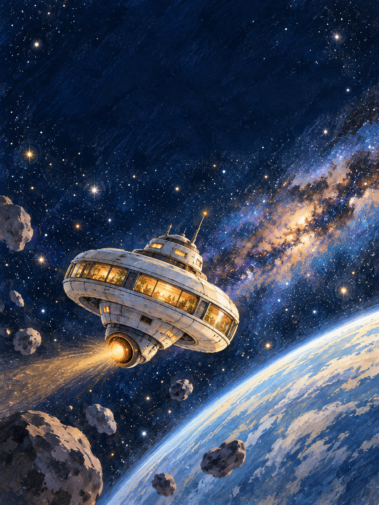

飞船叫“回声号”。

它不大，像一只银色的陀螺，尾巴上挂着一盏暖黄色的小灯。飞起来的时候，船身会发出“嗡——”的声音，像一只睡着的猫在打呼噜。

为什么叫“回声号”？

张铭轩说：“因为你朝宇宙喊一声，要等很久，才能听见回答。”

王一初说：“也可能没人回答。”

张铭轩说：“那就再喊一声。”

---

<!-- p08 -->

## 08 · 船上的五个人

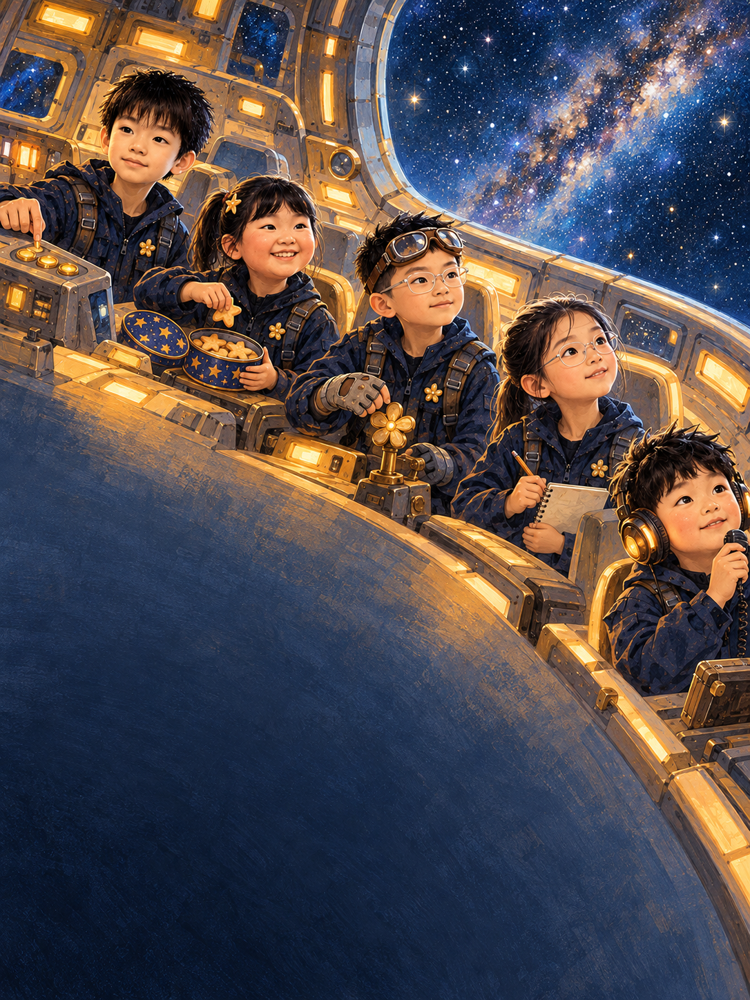

船上有五个人。

指令长张铭轩，说话总是慢半拍，好像每个字都要先在嘴里排队。他下命令之前，会用手指在控制台上轻轻敲三下。咚、咚、咚。

驾驶员张楚珺，最喜欢数字。她能一口气背出十五点九二，连做梦都在数星星。她数过船上的饼干：四十三块。每天数一遍。

机械臂手汤兴昊，管那朵金属花叫“花瓣”。每次开工前，他都要拍拍它：“乖，今天也别夹到我。”他有一只幸运手套，大拇指上有个洞，可他死活不肯换。

科学官赵以清，随身带一本小本子，封面写着：“奇怪，但是真的。”她走路很轻，说话也很轻，可她说的话，常常让人一晚上睡不着。

通讯员王一初，耳机从不摘。就算没人说话，他也会认真地“收到”一声。大家笑他，他也不生气，只是再“收到”一次。

五个人，一艘船。在这片黑暗里，他们就是全部的人类了。

---

<!-- p09 -->

## 09 · 蓝珠与 K-16

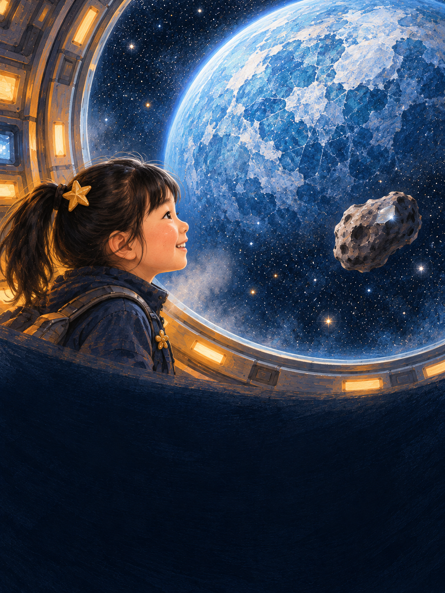

第十二年，“回声号”到了。

窗外出现一颗蓝色的冰矮行星。它不大，圆圆的，像一颗冻住的玻璃弹珠。表面有一层薄薄的蓝色雾，边缘被远处的太阳照出一圈很淡的光。

张楚珺把脸贴在窗上，呼出的气在玻璃上结了一小片白雾。

“好小啊。”她说。

“好老啊。”赵以清说，“它比地球还老。”

它身边，有一颗小石头，正在慢慢地绕圈。

那颗小石头，就是 K-16。

K-16 不大，形状歪歪的，像一颗被谁咬了一口的土豆。它转得不快，慢得让人想给它倒一杯热水。

张楚珺看着看着，忽然说：“我给它起了个名字，叫蓝珠。”

张铭轩说：“别给任务目标起名字，会有感情的。”

张楚珺说：“太晚了。”

---

<!-- p10 -->

## 10 · 不是信号

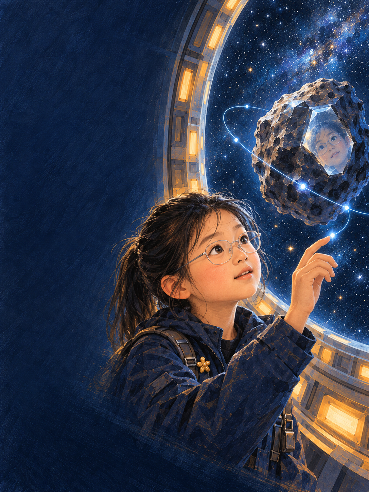

张楚珺盯着屏幕，报出数据：“自转周期，十五点九二小时。”

赵以清推了推眼镜，把屏幕放大。再放大。

“那道眨眼的光……”她停了一下，“是它在转。”

原来，K-16 的表面有一小片光滑的地方，像一块被谁擦亮的镜子。每转一圈，它就把远处微弱的光反射过来一次。

所以，每十六个小时，我们就看见一次“眨眼”。

不是信号。是一块石头在眨眼。

王一初小声说：“收到。”

没有人问他收到了什么。

---

<!-- p11 -->

## 11 · 第二颗

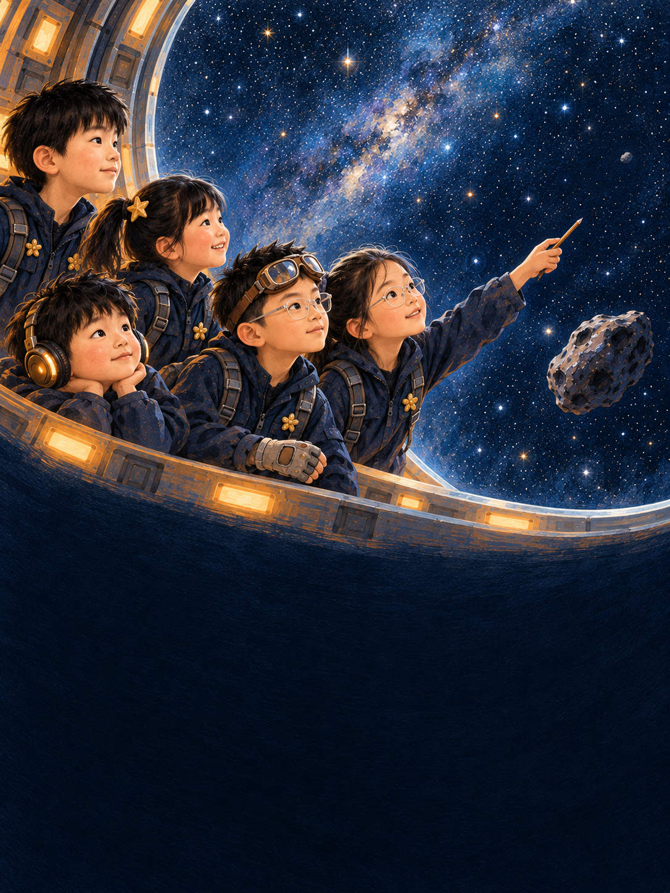

可赵以清没有离开屏幕。

她把亮度调到最高，又调高一次。屏幕黑得像一块墨。她眯起眼睛，在墨里找。

找到了。

在 K-16 的后面，很远很远的地方，还有一颗小石头。它小得像一粒灰尘，暗得像一颗快要熄灭的星。

“它不是一颗。”赵以清说，“它是两颗。”

“两颗？”张铭轩走过来。

“四十多亿年前，它们就开始互相绕着转。”赵以清用笔尖点了点屏幕，“中间那片黑暗，就是它们的轨道。”

船舱里安静极了。只有“回声号”的“嗡——”声，像一只猫翻了个身。

---

<!-- p12 -->

## 12 · 只取一块

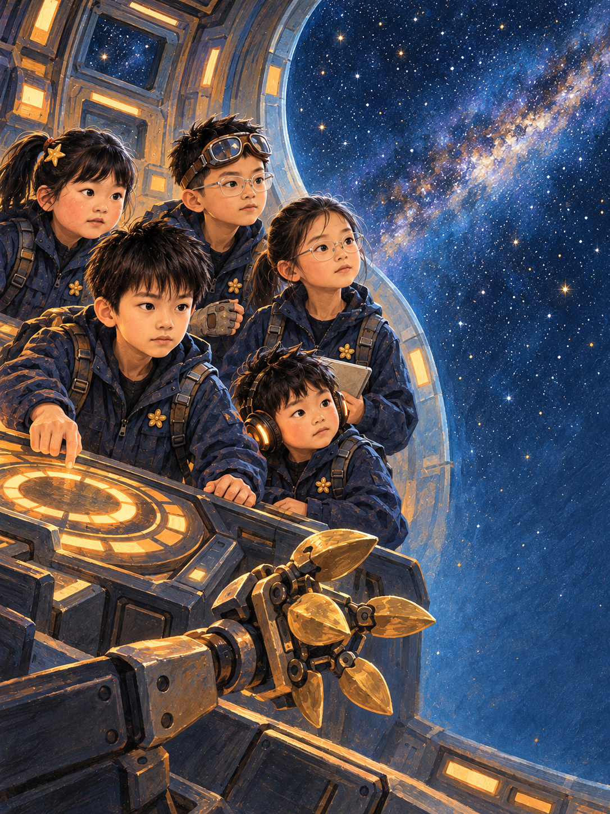

张铭轩清了清嗓子。

“任务：取回一块太阳系出生时的石头。只有一次机会。”

为什么要取？因为 K-16 可能保存着太阳系的第一口气。四十六亿年，没有人碰过它。

张楚珺看了一眼计时器：“轨道窗口，九十秒。”

汤兴昊戴上他的幸运手套，把手套上的洞对准大拇指：“花瓣，开工。”

王一初对着耳机说：“回声号，准备采样。”

耳机里传来沙沙的电流声。他又说了一遍：“收到。”

---

<!-- p13 -->

## 13 · 金属花

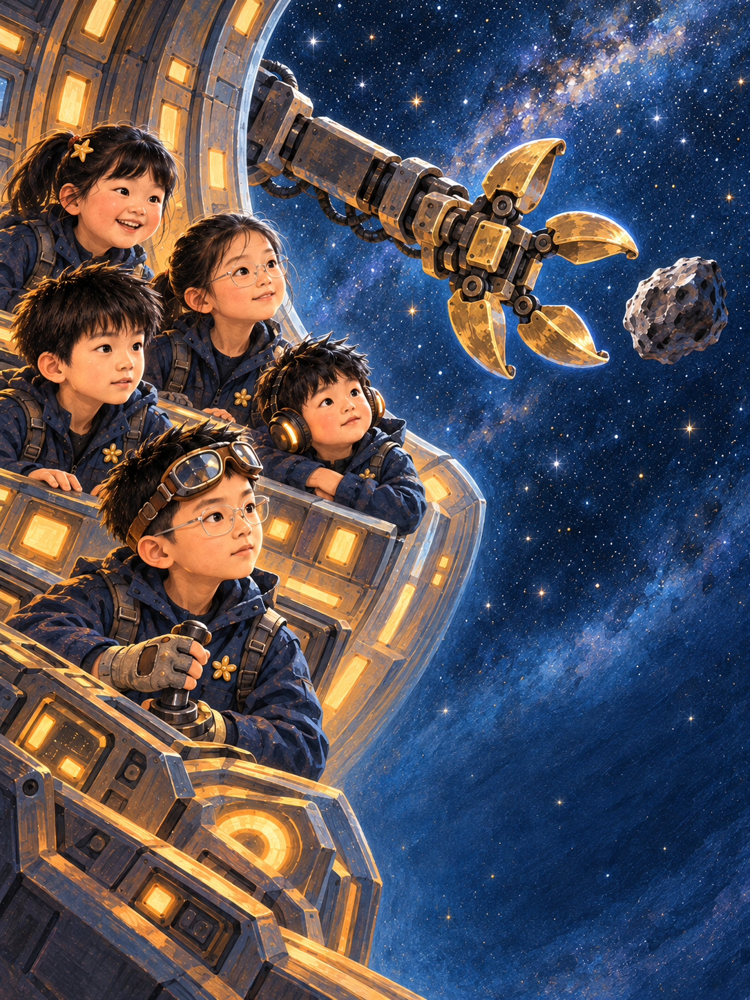

机械臂慢慢伸出去。

末端是一朵五瓣的金属花。黄铜色，冷冰冰的，关节上还有几道细细的划痕。可是张开的时候，真的很像一朵花。

五片花瓣，一片，一片，打开。

咔。咔。咔。

汤兴昊屏住呼吸：“别急，别急……”

---

<!-- p14 -->

## 14 · 三次落空

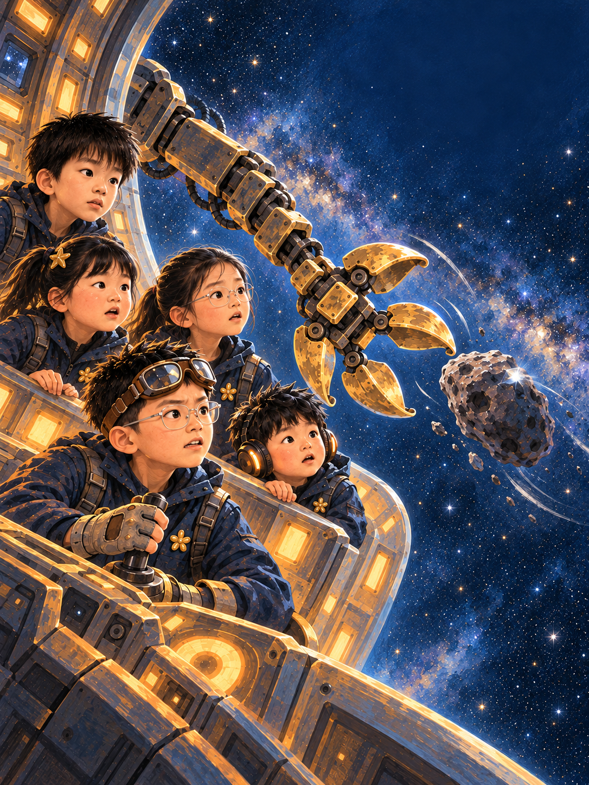

K-16 在转。它转得不快，可每一次，都刚好在花瓣合拢之前，把身体转开。

第一次，落空。

第二次，擦过。

第三次，花瓣只差一点点。

张楚珺报数：“下一个窗口，十六分钟后。”

汤兴昊抹了一把汗：“等不了十六分钟。”

---

<!-- p15 -->

## 15 · 像在等我们

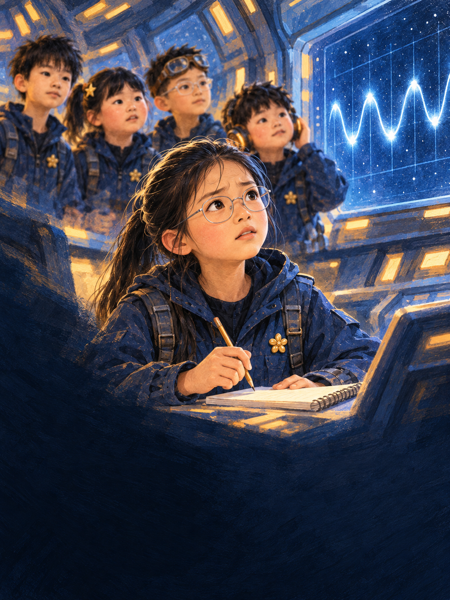

赵以清一直盯着屏幕。

她的笔在本子上停住了。

“它的自转……”她说，“太稳了。”

“稳不好吗？”王一初问。

“太稳了。”赵以清抬起头，“像在等我们。”

船舱里安静了一下。

只有 K-16 还在转。一圈，又一圈。不慌不忙，像它已经这样转了四十六亿年，还可以再转四十六亿年。

---

<!-- p16 -->

## 16 · 咔哒

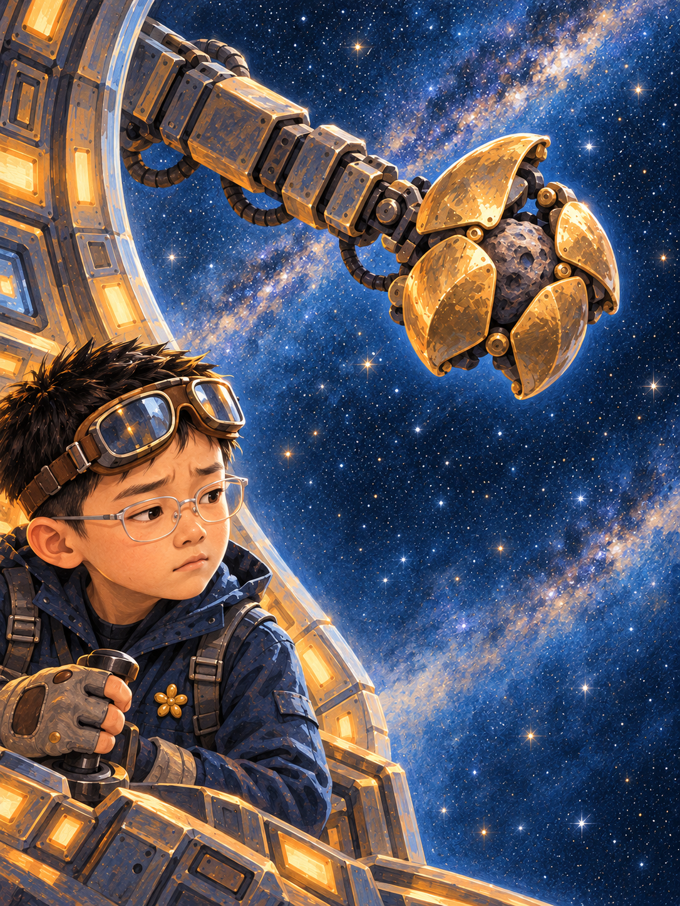

第四次。

花瓣张开，停了一秒。

然后，猛地合拢。

咔哒。

抓住了。

音乐停了。所有人都没有说话。

K-16 离开了它的轨道，安安静静地躺在花心里，像一颗睡着了的小土豆。

汤兴昊盯着它看了很久，忽然小声说：“对不起啊。”

“你说什么？”张楚珺问。

“没什么。”他把幸运手套往下拉了拉。

---

<!-- p17 -->

## 17 · 空空的圆

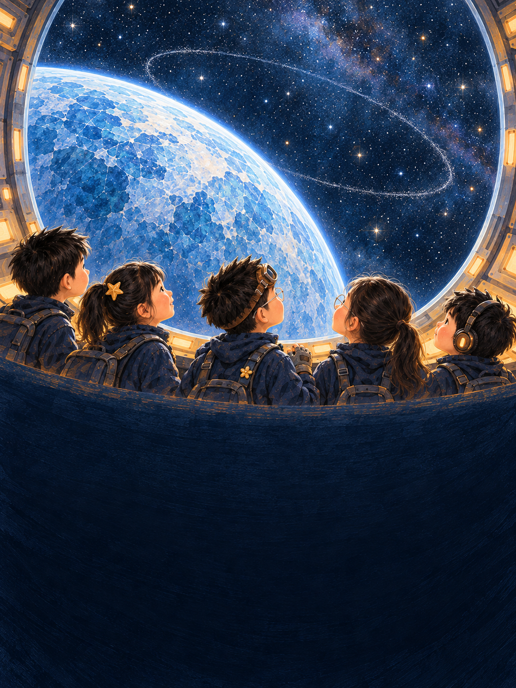

张楚珺把船往后撤了一点。

窗外，K-16 原来的位置空了。

那个空空的圆，像谁用橡皮擦，轻轻擦掉了一颗星星。

王一初报告：“样本已封装。”

他顿了顿，又补了一句：“……我们回家吗？”

张铭轩没有马上回答。他看着那个空空的圆，手指在控制台上轻轻敲了三下。

咚、咚、咚。

---

<!-- p18 -->

## 18 · 多闪了一下

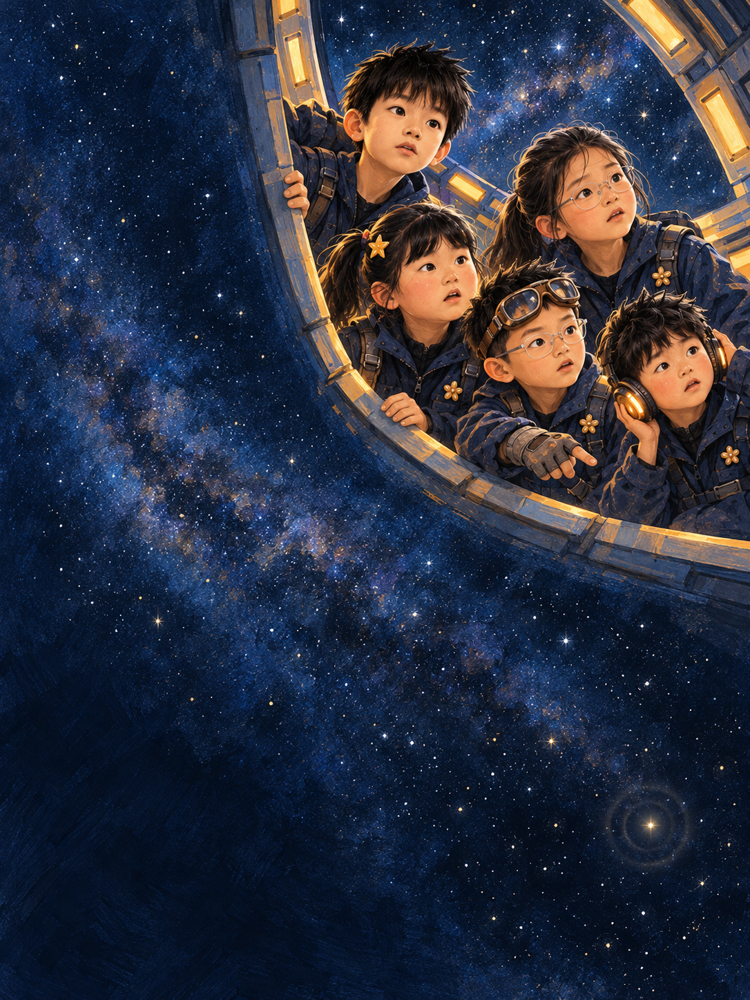

就在这时，背景的星星亮了一下。

这是任务成功的信号。每次抓住样本，“回声号”都会让星星闪一闪，像在说：干得好。

可是赵以清发现，有一颗星，比别的星多闪了一下。

闪。闪。

“等等——”她说，“那颗星，比别的星，多闪了一下。”

张铭轩问：“哪颗？”

赵以清指着屏幕最暗的角落：“背景最暗的那颗。”

王一初凑过来看。他看了很久，说：“收到。”

这一次，没有人笑他。

---

<!-- p19 -->

## 19 · 一千个它

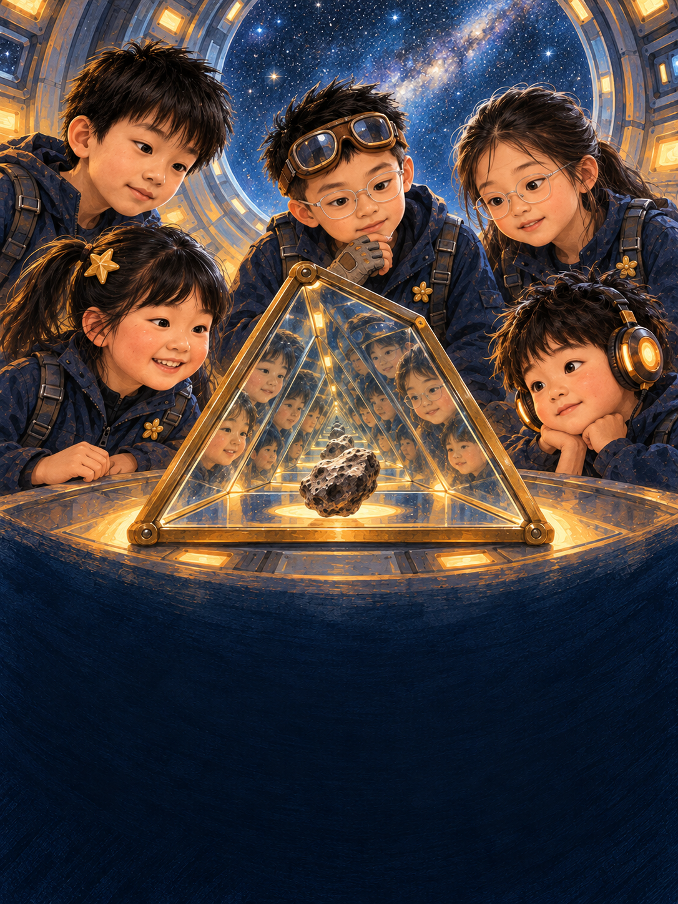

K-16 被送进一个三角形的玻璃舱。

舱里有三面镜子。石头落进去的一瞬间，镜子里出现了第二个它，第三个它，第一百个它……

一个，变成了一千个。

张楚珺看得入神：“好多 K-16 啊。”

“可它们都是同一个。”赵以清说。

她想起远处那颗最暗的星。它没有镜子。它只有一个自己。

她把这句话写进本子里，写得很慢。

---

<!-- p20 -->

## 20 · 返航

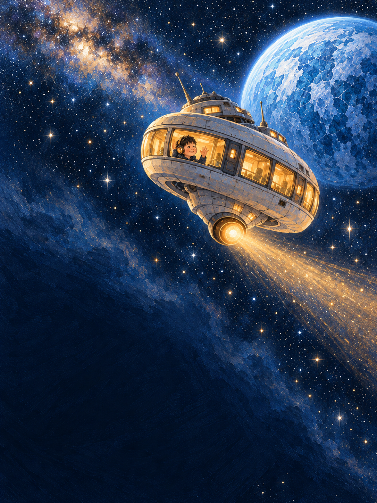

张铭轩下令：“返航。”

推进器亮了。

“回声号”慢慢转身。蓝色的冰矮行星在窗外一点一点变小，最后变成一颗蓝色的纽扣。

王一初对着耳机说：“这里是回声号。样本已封装，准备返航。”

说完，他又小声加了一句：“……再见。”

耳机里只有沙沙的电流声。

他不知道自己在跟谁说再见。

---

<!-- p21 -->

## 21 · 再看它一眼

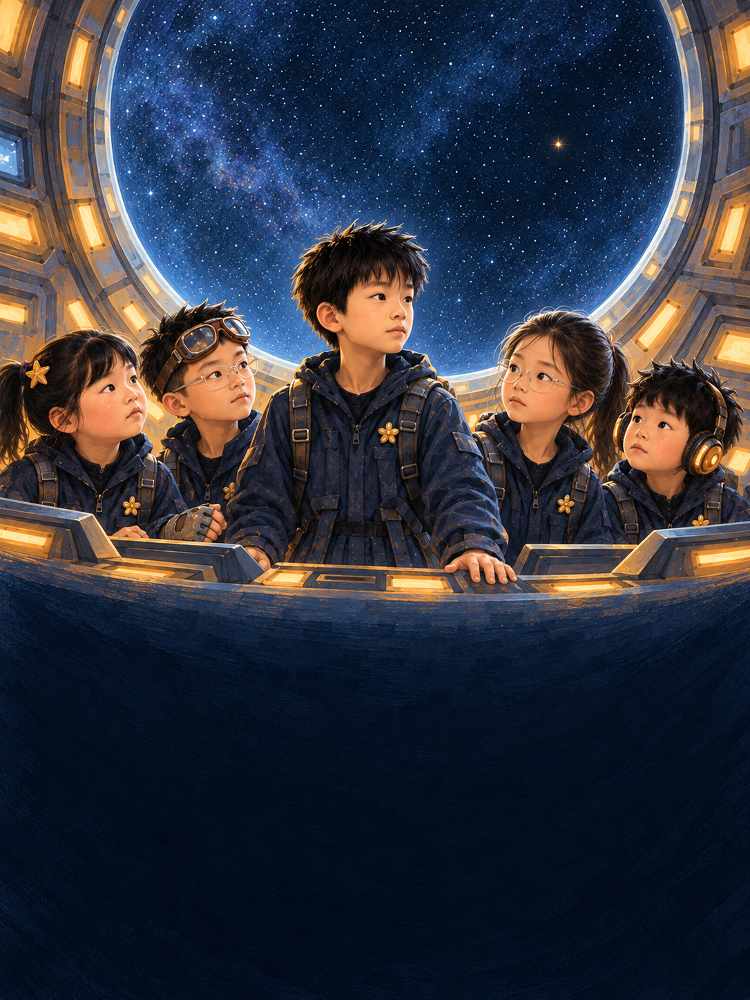

张铭轩忽然说：“等等。”

所有人都看着他。

他说：“再看它一眼。”

张楚珺把船头转回去。

窗外的星星，还是那些星星。K-16 的位置，还是空的。

只有那颗最暗的星，还在原地。

赵以清把镜头推到最近。

她本来只是想再看一眼那颗星。

可是，她的手停住了。

---

<!-- p22 -->

## 22 · 闭着的眼睛

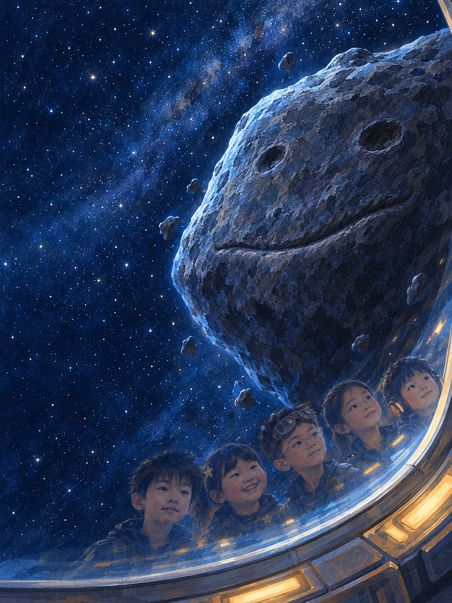

那颗“星”不是星。

它是一块石头，一块像陨石一样的石头。它的表面有两个黑黑的坑，中间有一道弯弯的山脊。

看上去，像一只闭着的眼睛。

张楚珺倒吸了一口凉气。

王一初的耳机里，传来一声很轻的“沙”。

赵以清的本子上，笔尖停在一个没写完的字上。

然后，那道山脊动了。

---

<!-- p23 -->

## 23 · 睁开

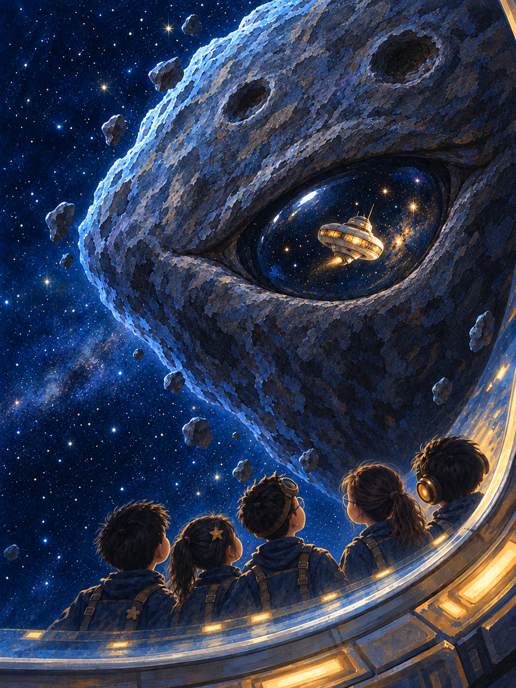

很慢，很慢。

像一个人睡了很久，终于想起要睁开眼睛。

山脊一点一点抬起。下面露出深色的、玻璃一样的表面。

眼睛睁开了。

瞳孔里没有凶光，也没有怒火。只有一点小小的、暖黄色的光——

那是“回声号”尾巴上的灯。

它看着那艘越来越小的飞船。

也看着屏幕前的我们。

---

<!-- p24 -->

## 24 · 它只看过一样东西

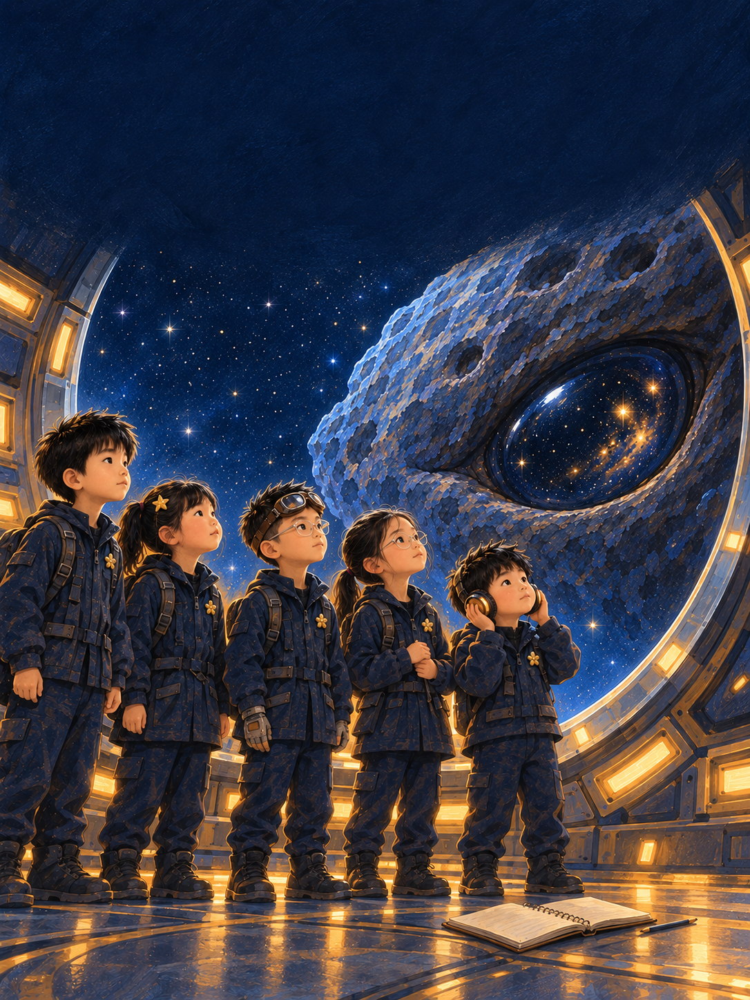

赵以清的本子掉在地上。

没有人去捡。

张铭轩轻轻地说：“四十六亿年里，它只看过一样东西。”

“什么东西？”张楚珺问。

张铭轩没有回答。

他看着那只眼睛，看着瞳孔里那一点暖黄色的光。

王一初的耳机里，只剩下电流的沙沙声。

现在，它看着我们。

---

<!-- p25 -->

## 25 · 回家的路

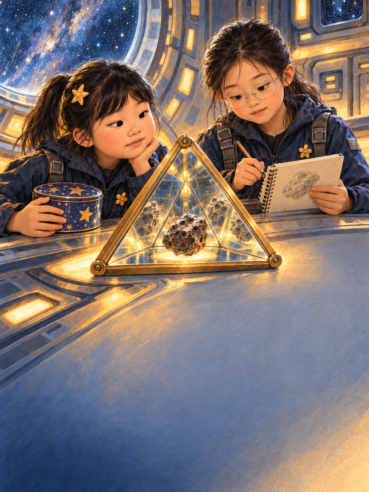

回地球的路，还是十二年。

K-16 躺在万花筒里，安安静静。可每次有人经过，都会忍不住看一眼那个三角形的舱。

他们总会想起，远处还有一颗石头，睁着眼睛，看着他们离开。

张楚珺又数了一遍饼干。还是四十三块。

她没有吃。

赵以清在本子上写下最后一句话：“它睁眼了。”

然后，她在这句话下面，画了一只小小的眼睛。

---

<!-- p26 -->

## 26 · 后悔吗

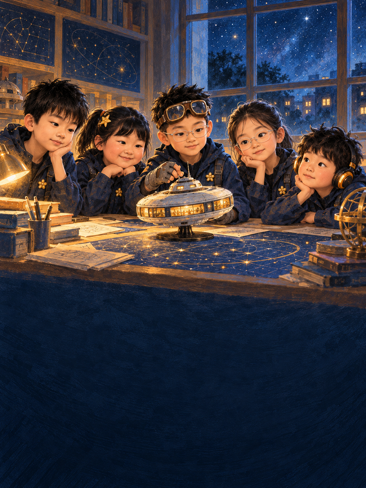

后来，有人问：“你们后悔吗？”

五个人都没有马上回答。

最后，张楚珺说：“我们只是去看了一眼。”

赵以清补了一句：“可有些东西，看一眼，就会改变它。”

张铭轩敲了三下桌子。咚、咚、咚。

王一初说：“收到。”

这一次，大家都笑了。

笑着笑着，又不笑了。

---

<!-- p27 -->

## 27 · 如果你也去

如果你也有机会，去很远很远的地方，看一颗会眨眼的星星。

记得先问一问：

它是不是，正在等它的伴？

然后再决定，要不要伸出手。

因为有些光，不是信号。

有些石头，不是石头。

有些“看一眼”，会看很久，很久。

---

<!-- p28 -->

## 28 · 我们走了

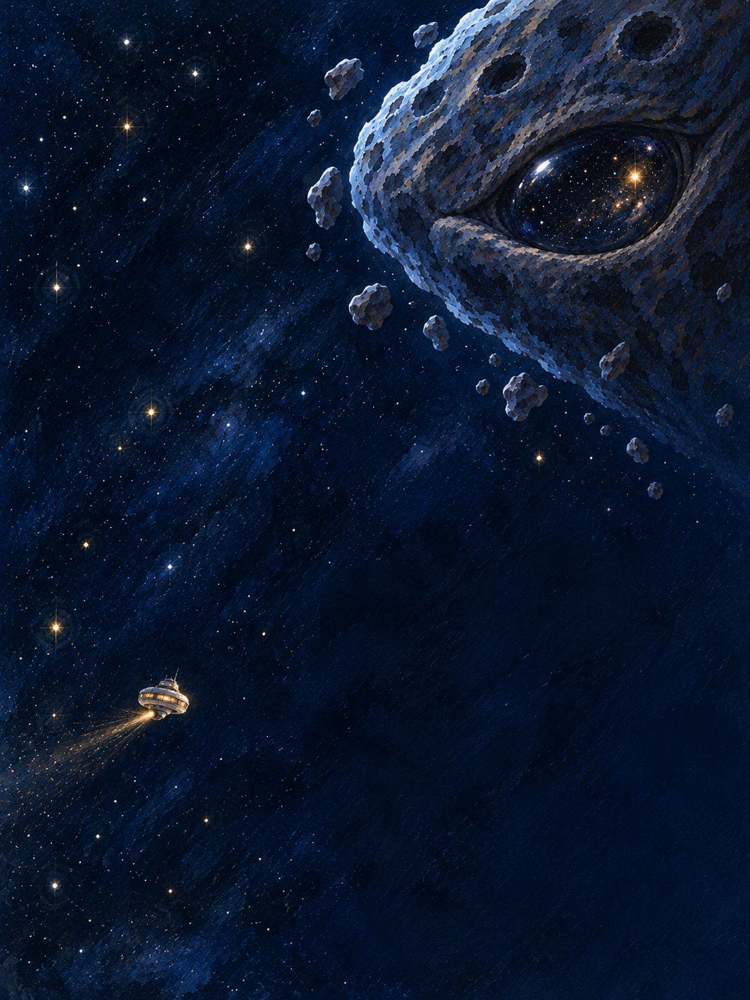

“回声号”越来越小，最后变成黑暗里的一点暖黄色。

那颗石头还在原地。

它睁着眼睛。

它没有追上来。

它只是看着。

我们走了。

它还在看。

---

<!-- p29 -->

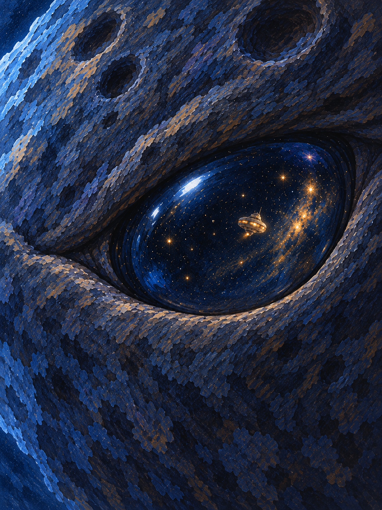

---

<!-- p30 -->

## 30 · 作者的话

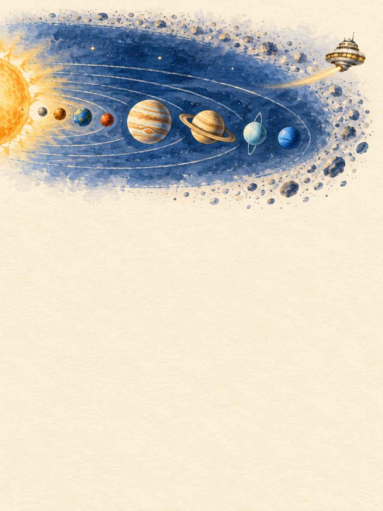

这个故事里，有些数字是真的。

柯伊伯带离太阳约六十五亿公里，表面温度约零下二百三十三度。K-16 的自转周期十五点九二小时，参考了真实的柯伊伯带天体 Arrokoth（2014 MU69）。它是一颗“接触双星”，由两个瓣状天体在太阳系诞生初期轻轻合在一起。

“石头是活的”是我们的想象。但四十六亿年的时间，是真的。

希望你在合上书之后，记住一句话：

**探索不是把世界带走，而是先学会看见。**

---

<!-- p31 -->

## 31 · 知识小口袋

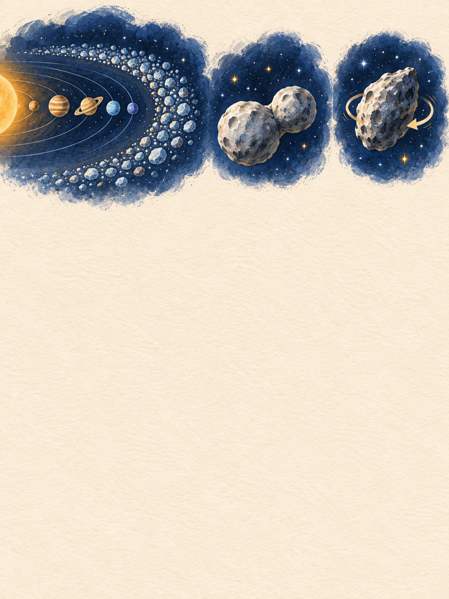

**柯伊伯带在哪里？**  
在海王星外面，离太阳大约三十到五十个天文单位。故事里的六十五亿公里，大约是四十三个天文单位。

**为什么那里那么冷？**  
因为太阳的光到了那里已经很弱。那里的天体表面大约只有零下二百三十三度，比液氮还冷。

**十五点九二小时是什么？**  
是 K-16 转一圈的时间。真实的 Arrokoth 自转周期大约是十五点九二小时，和故事里一样。

**什么是双星？**  
两颗天体互相绕着转，就叫双星。有的双星靠得很近，甚至粘在一起，叫“接触双星”。

**为什么科学家想取回这块石头？**  
因为柯伊伯带的天体是太阳系出生时留下的原始材料。它们可能保存着太阳系早期的信息，像一封四十六亿年前寄出的信。

**石头真的会活着吗？**  
这是故事里的想象。真实的天体没有证据表明是活的。但它们确实有自己的历史，有自己的时间。我们不一定要把它带走，才可以认识它。

---

<!-- p32 -->

## 32 · 封底

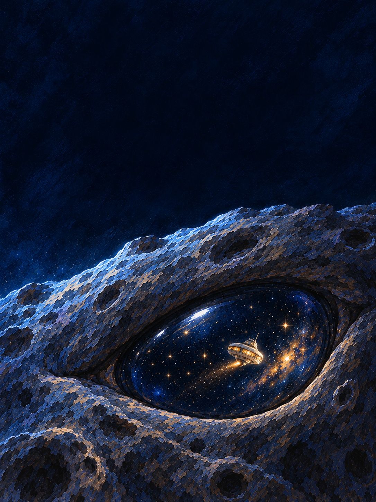

我们飞了十二年，只为去看一眼。

有些光，不是信号。  
有些石头，不是石头。  
有些“看一眼”，会看很久，很久。
