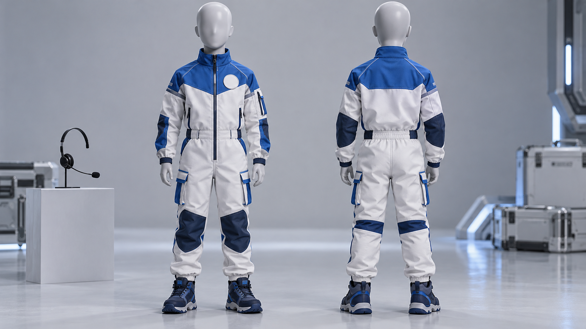
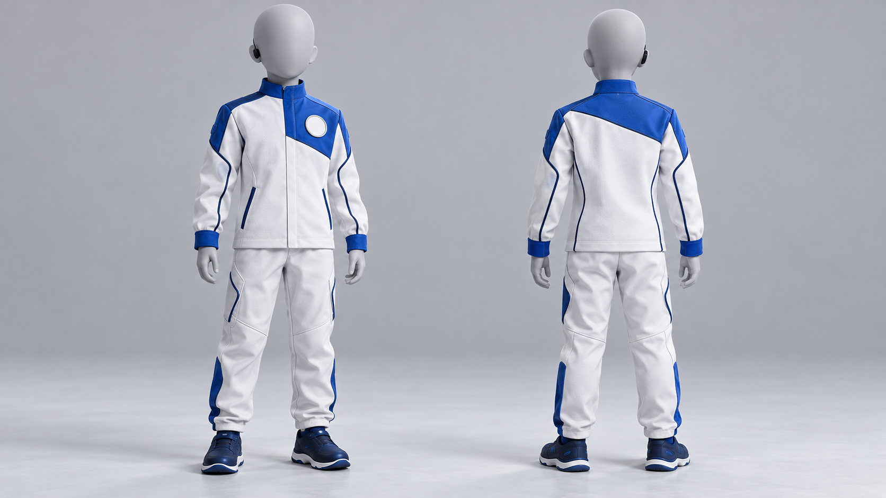
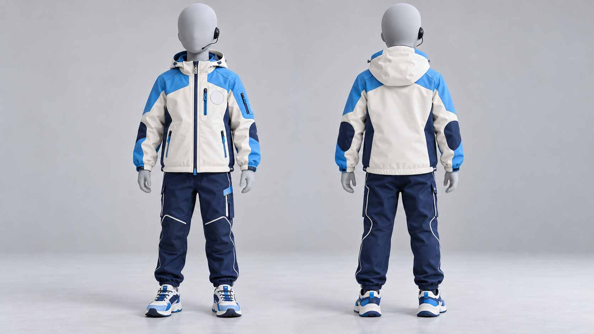
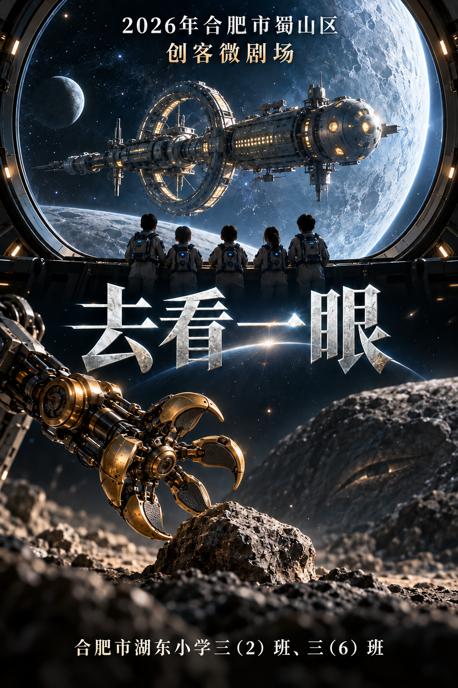
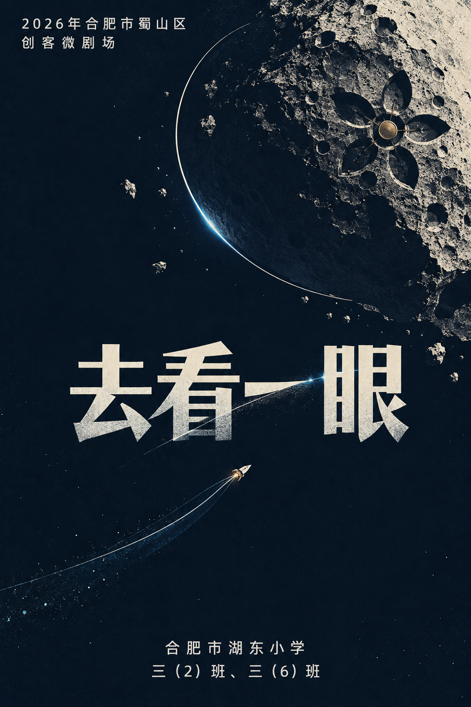
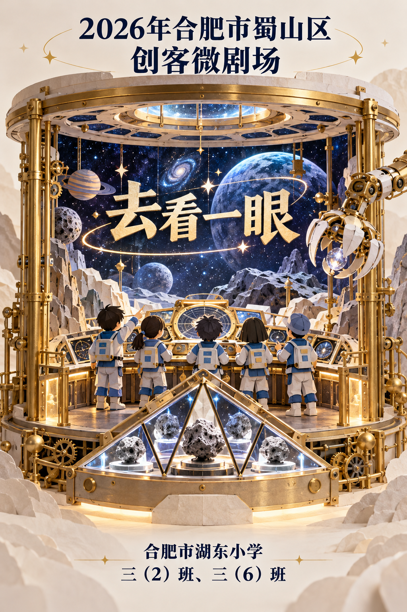

# 科考服、海报与队徽候选

由内置imagegen生成，三组各三款，共九张选用候选。每张完整提示词保存在同目录的同名.prompt.txt文件中；来源与迭代记录见[imagegen生成记录.json](imagegen生成记录.json)。

海报活动标题：2026年合肥市蜀山区创客微剧场；作品名：去看一眼；学校信息：合肥市湖东小学三（2）班、三（6）班。文字已逐张目视核对。海报为风格候选，不作为影片场景或物理尺度母版。

科考服使用儿童比例人台，不是五位成员定妆成品，左胸预留空白队徽位置。队徽均为1:1白底位图，不是矢量或透明底文件。

## 科考服

### A 航天工装

结构扎实、口袋与关节拼接丰富。1672×941。

[原图](科考服/A_航天工装.png)
### B 简洁未来

线条利落、简洁舰桥制服。1672×941。

[原图](科考服/B_简洁未来.png)
### C 少年探索

轻便亲和、蓝白软壳外套与深蓝裤。1672×941。

[原图](科考服/C_少年探索.png)

## 海报

### A 电影史诗

大型飞船、五人背影、五瓣抓手。1024×1536。

[原图](海报/A_电影史诗-v2.png)
### B 极简悬疑

深蓝留白、岩石与探索航迹。1024×1536。

[原图](海报/B_极简悬疑.png)
### C 微剧场艺术

纸雕层次与金属圆柱剧场装置。1024×1536。

[原图](海报/C_微剧场艺术.png)

## 队徽

### A 五瓣星石

五片机械瓣叶、岩石、五人圆点。1254×1254。

[原图](队徽/A_五瓣星石-v2.png)
### B 三角航迹

三角样本舱、岩石与五个航迹圆点。1254×1254。

[原图](队徽/B_三角航迹.png)
### C 五人远望

五人剪影、舷窗与探索飞船。1254×1254。

[原图](队徽/C_五人远望.png)

## 选择方式

请分别选择科考服A/B/C、海报A/B/C、队徽A/B/C，也可指定组合或修改。海报A与队徽A采用-v2修正版，初稿保留追溯但不进入选用九图。
