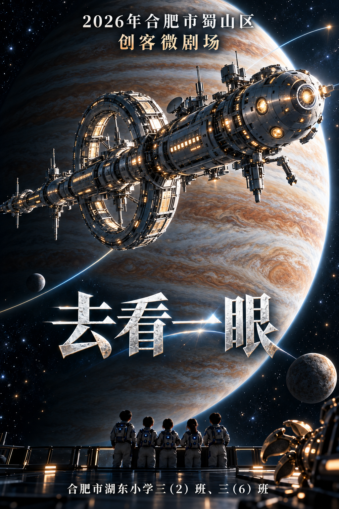
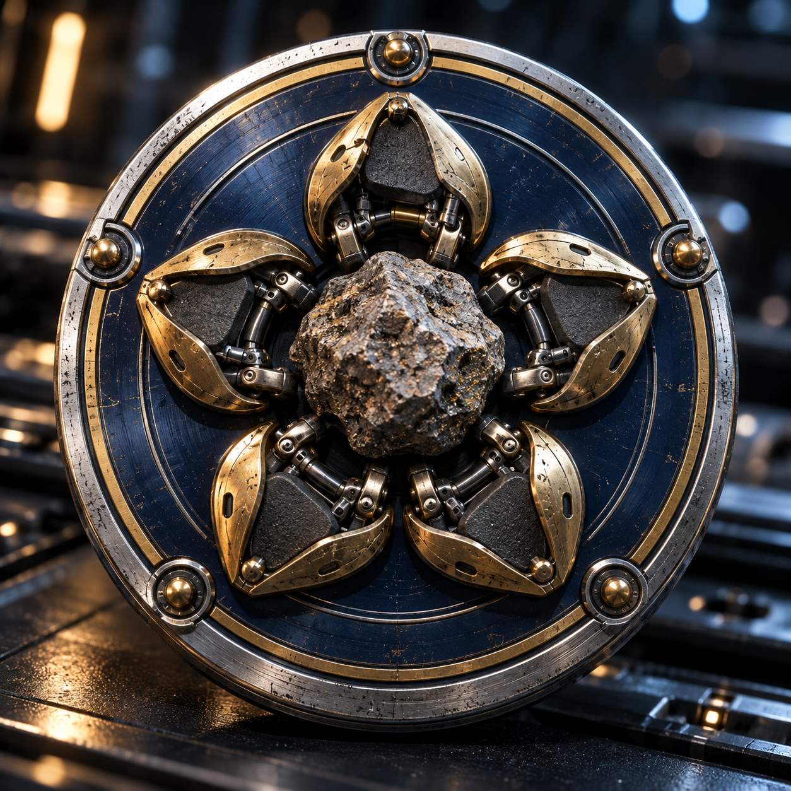
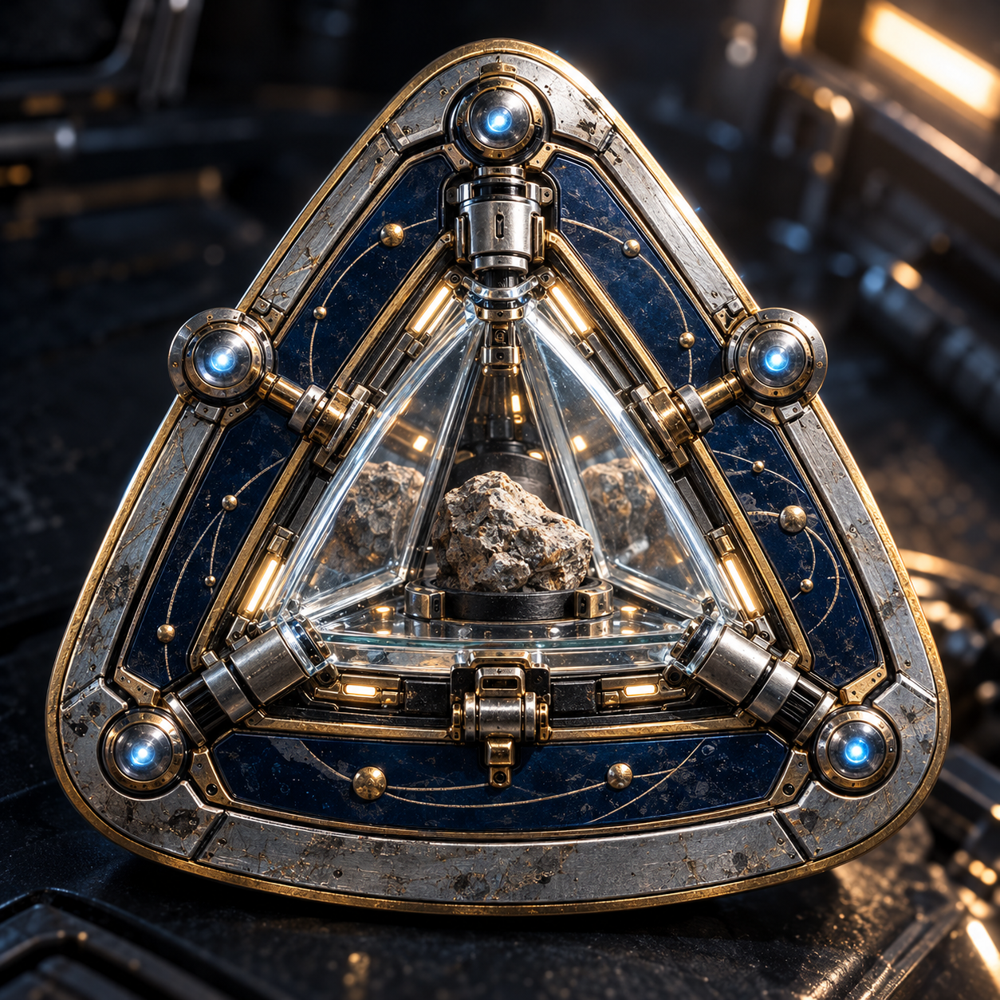
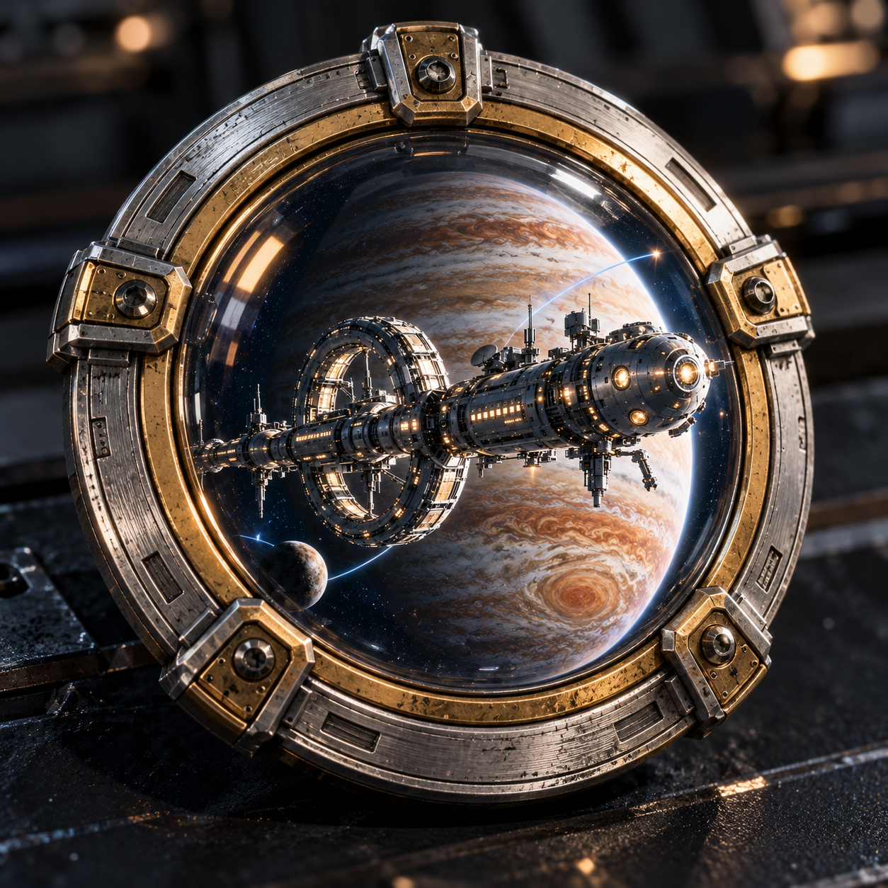

# 第三轮：无眼海报与写实电影队徽

由内置imagegen生成。第一、二轮全部保留，本轮另存。各图完整提示词保存在同目录同名.prompt.txt，来源见[imagegen生成记录.json](imagegen生成记录.json)。

海报已目视核对顶部活动标题、中间作品名与底部学校及两个班级信息，未出现石头眼睛。队徽改为电影实物摄影质感，不采用板绘/扁平插画；三款均为1:1位图，当前是效果图，尚非透明底或矢量成品。

## 海报 · 大飞船无眼版

保留大飞船、木星、开放示意航迹及五人背影；岩质天体只保留自然纹理，不暗示眼睛。

[原图](海报/A_大飞船无眼版.png) · 1024×1536

## 队徽 A · 五瓣捕获

真实黄铜五瓣抓手、粗糙岩石、钛银外圈和深蓝釉面。

[原图](队徽/A_五瓣捕获_电影实物.png) · 1254×1254

## 队徽 B · 三角样本

镜面样本舱、真实玻璃折射、机械铰链与岩石倒影。

[原图](队徽/B_三角样本_电影实物.png) · 1254×1254

## 队徽 C · 远望舷窗

与海报同风格的科考飞船、木星与实体舷窗框。

[原图](队徽/C_远望舷窗_电影实物.png) · 1254×1254

