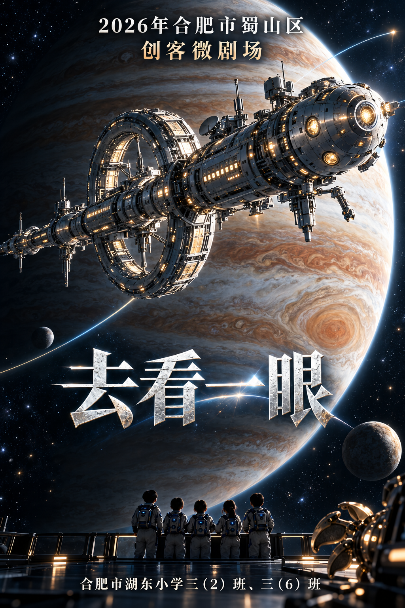

# 第二轮：大飞船海报与艺术科技队徽

使用内置imagegen生成。第一轮全部图片保留在上级目录，未覆盖。每张完整提示词在同目录同名.prompt.txt中，来源记录见[imagegen生成记录.json](imagegen生成记录.json)。

## 新版电影海报

放大飞船主体，木星背景、开放式引力辅助示意航迹与五人背影；保留活动标题、作品名和完整学校信息。

1024×1536；[原图](海报/A_大飞船引力辅助.png)

## 队徽 A · 五瓣光圈

五片金属陶瓷花瓣、中央岩石与五个节点，呼应五位成员与五瓣抓手。

1254×1254；[原图](队徽/A_五瓣光圈.png)

## 队徽 B · 三角折光

三角镜面舱、蓝玻璃折射、金属边框与五个节点。

1254×1254；[原图](队徽/B_三角折光.png)

## 队徽 C · 远望之眼

圆形舷窗、温和眼睛、岩石瞳孔与飞船航迹的融合。

1254×1254；[原图](队徽/C_远望之眼.png)

海报中的航迹是设计示意，不是实体发光轨道；人物是五人背影概念，不是五位成员的身份定稿。队徽为1:1白底位图，适合屏幕方案比较，尚非透明底或矢量文件。
