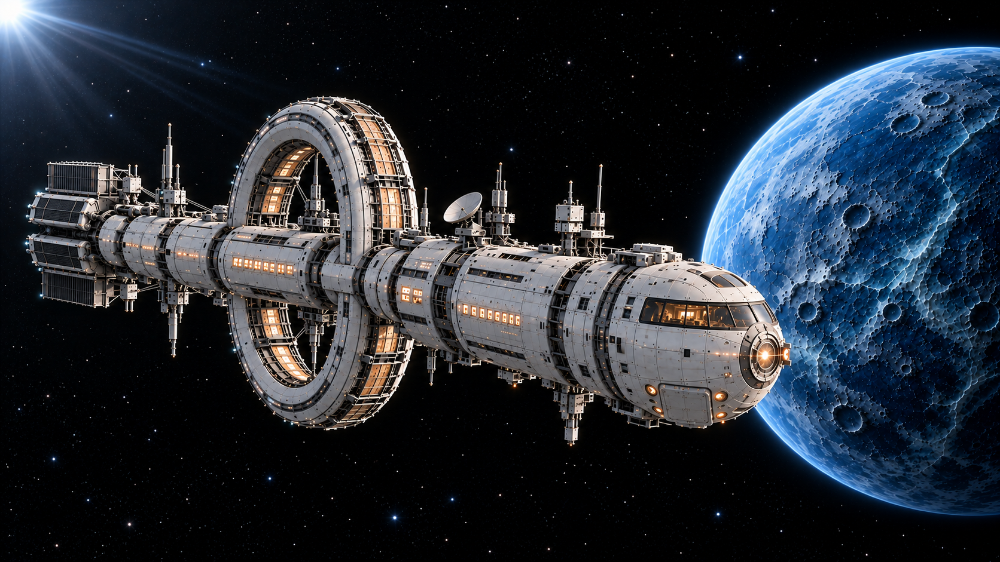

> 抓手最新选图：KF08A—KF09B改用[朝石头v3](抓手朝向修正索引_v3.md)，原v2朝镜头抓手不再使用。飞船转向选图仍沿用整船朝屏幕外v2。

# 修正选图 v2

本次使用内置 imagegen 修正四张缺瓣抓手及整船转向终态。旧版保留，下列为当前选图。

四张抓手都可数出五个独立金色花瓣及黑色内垫；统一参照 open_v1。两次失败的石头位置与机械臂高低关系保留。

转向起态继续使用KF14C-v1，该帧船身本来就是直线刚性连接，无需重绘。终态改用KF14D-v2：整船朝屏幕外旋转，船身纵轴一起改变，大环更接近正面、尾部缩短，船头没有独立偏折。制作视频时要求整船作为一个刚体旋转，所有舱段中心保持共线；不要沿用旧版D或旧说明中的约30度角度限制。

[本次提示词](提示词/五瓣与整船转向修正_v2.txt)

## KF08A_第一次抓偏_接近起态_五瓣校正_v2.png

## KF08B_第一次抓偏_偏低停住_五瓣校正_v2.png

## KF09A_第二次擦过_高度对准起态_五瓣校正_v2.png

## KF09B_第二次擦过_石头掠过外缘_五瓣校正_v2.png

## KF14C_飞船返航转向_起态_v1.png

## KF14D_飞船返航转向_整船朝屏幕外_v2.png

