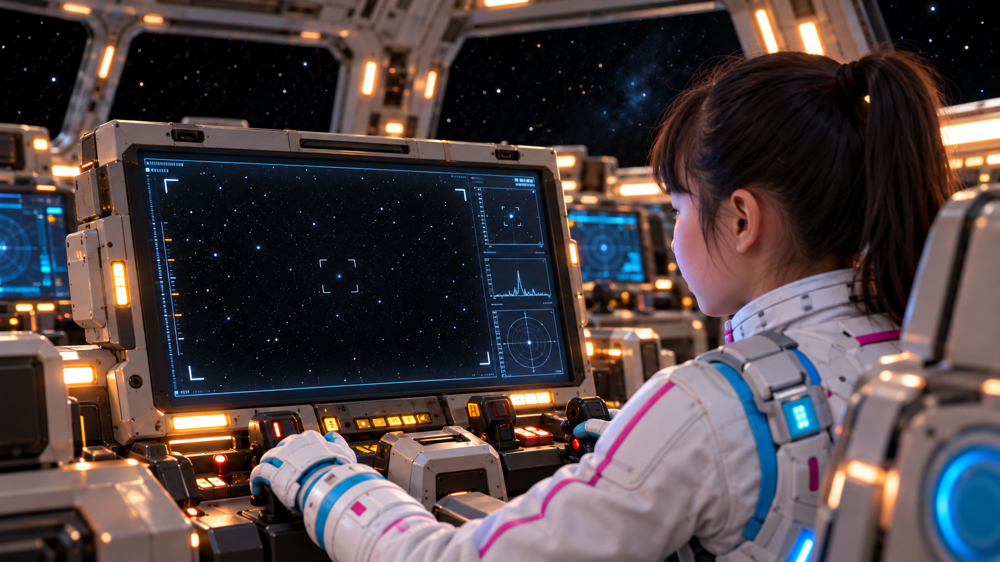
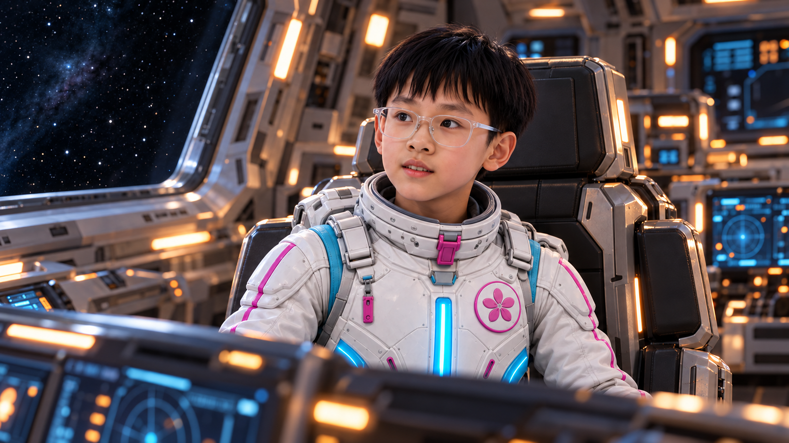
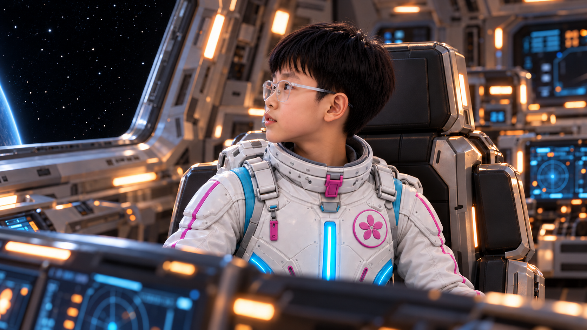
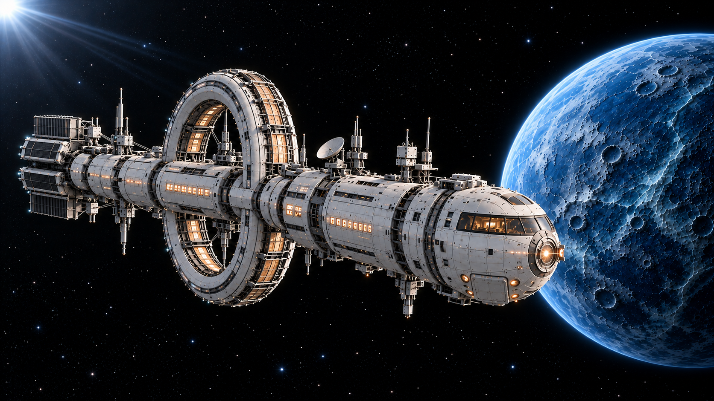
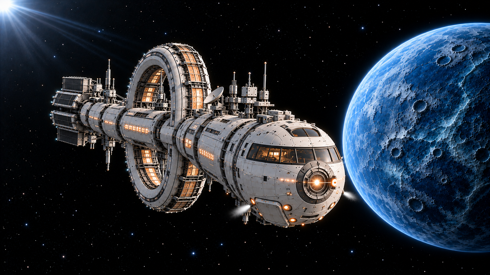

> 抓手最新选图：KF08A—KF09B改用[朝石头v3](抓手朝向修正索引_v3.md)，原v2朝镜头抓手不再使用。飞船转向选图仍沿用整船朝屏幕外v2。

> 当前选图更新：四张失败抓取改用五瓣校正版，转向终态改用整船朝屏幕外版。见[修正选图索引 v2](修正选图索引_v2.md)。下方旧版图片保留作历史记录。

# 逐镜补充关键帧索引

2026-10-31。按《标准画面缺口检查》的逐镜关键帧部分补充，使用内置 imagegen；共11张单幅图片，原始提示词及参考路径见[提示词目录](提示词/)。本轮没有提交视频任务。

## 本轮画面

| 画面 | 用途 |
|---|---|
| [KF08A_第一次抓偏_接近起态_v1.png](KF08A_第一次抓偏_接近起态_v1.png) | 接近起态，抓手偏低且尚未接近 |
| [KF08B_第一次抓偏_偏低停住_v1.png](KF08B_第一次抓偏_偏低停住_v1.png) | 偏低停住，仍未接触 |
| [KF09A_第二次擦过_高度对准起态_v1.png](KF09A_第二次擦过_高度对准起态_v1.png) | 高度对准，仍有相对运动，尚未接触 |
| [KF09B_第二次擦过_石头掠过外缘_v1.png](KF09B_第二次擦过_石头掠过外缘_v1.png) | 石头沿外缘经过，抓手仍张开无接触 |
| [KF02A_远距观测屏_闪光前暗态_v1.png](KF02A_远距观测屏_闪光前暗态_v1.png) | 科学官看远距观测屏，目标点暗态 |
| [KF02B_远距观测屏_闪光亮态_v1.png](KF02B_远距观测屏_闪光亮态_v1.png) | 同机位目标亮态 |
| [KF02C_张楚珺发现闪光_转头提醒_v1.png](KF02C_张楚珺发现闪光_转头提醒_v1.png) | 科学官发现闪光，转头提醒同伴 |
| [KF02D_王一初回应闪光_中近景_v1.png](KF02D_王一初回应闪光_中近景_v1.png) | 指令长回应；亦可作为回望前中性姿态 |
| [KF14B_王一初回望_等等再看一眼_v1.png](KF14B_王一初回望_等等再看一眼_v1.png) | 指令长转向舷窗回望 |
| [KF14C_飞船返航转向_起态_v1.png](KF14C_飞船返航转向_起态_v1.png) | 样本已回收，返航转向前 |
| [KF14D_飞船返航转向_偏航终态_v1.png](KF14D_飞船返航转向_偏航终态_v1.png) | 开始返航转向，船首向摄影机偏航约30度 |

## 动作衔接

- 第一次失败：08A→08B。抓手朝石头前伸，但高度偏低，停在石头下方；全程张开，没有接触或抓牢。随后通过肩、肘关节抬高进入09A，末端小臂、腕部、抓手连接保持同轴。
- 第二次失败：09A→09B。先对准高度，石头沿轨道从开口外缘上方掠过，抓手保持张开。这里的“擦过”指近距离错过，没有碰撞、碎屑或弹飞。视频中保持石头连续缓慢运动，不能跳位；两次失败后再接成功抓取。
- 发现闪光：02A→02B→02A，可让亮点有节奏地闪两次；随后切02C张楚珺转头提醒，再切02D王一初回应。屏幕显示远距观测影像，尚未解析成清晰星球，不提前露出眼睛结构。台词沿用最终剧本与同学录音，图片不烧录字幕。
- 指令长回望：14B是“等等。再看它一眼”的目标姿态；需要转头起态时可参考02D的正侧中性姿态，但两张分属不同剧情时刻，窗外景物有变化，不能要求整幅画面原样插值。制作结尾动态时以14B锁定身份与舷窗背景，只让头部从较正姿态转向窗外。
- 返航转向：14C→14D，固定摄影机，整船开始向摄影机方向偏航，保持单一大环、舰桥与散热板随船刚性运动。这组表达转向开始的一段，不是一镜完成180度掉头；外舱门关闭，机械臂和回收舱都在船内。
- 建议结尾剪辑顺序：飞船开始转向→14B指令长说台词并回望→既有06A普通矮行星空轨道→既有06B睁眼。不要加解释它失去玩伴的旁白，也不要让人物提前知道。

## 连贯性与使用范围

采样画面采用从舱外看入真实开口的摄影机位，能看见真实内壁与舱门边框；不是剖去船壳的结构展示图。机械臂基座与中央回收舱位于舰桥正下方同一室内空间。五瓣抓手采用宽金属花瓣与黑色衬垫，侧向透视允许远侧瓣被遮挡，不可在动态中变成两爪钳。

两次失败属于舱外朝前抓取。成功后进入舱内的“朝下放置六阶段”仍以最新07组及全片视觉标准为准，不用本组朝前姿态覆盖放置规则。石头只有一颗，矿物反光面不持续自发光。

人物反应以各自正面、侧面定妆照锁定身份。王一初保留透明眼镜，张楚珺不戴眼镜；近景不代表重新安排其他四人的座位。静帧已做目视检查，视频生成后仍需检查脸部、五瓣数量与刚性关节是否在运动中漂移。

飞船、矮行星和画面主体已作参照匹配；生成帧的微小表面细节并非逐像素一致。闪光组适合固定镜头局部亮度变化，转向组须描述真正的三维刚体旋转，避免用整幅二维缩放代替转向。

## 预览

### KF08A_第一次抓偏_接近起态_v1

### KF08B_第一次抓偏_偏低停住_v1

### KF09A_第二次擦过_高度对准起态_v1

### KF09B_第二次擦过_石头掠过外缘_v1

### KF02A_远距观测屏_闪光前暗态_v1

### KF02B_远距观测屏_闪光亮态_v1

### KF02C_张楚珺发现闪光_转头提醒_v1

### KF02D_王一初回应闪光_中近景_v1

### KF14B_王一初回望_等等再看一眼_v1

### KF14C_飞船返航转向_起态_v1

### KF14D_飞船返航转向_偏航终态_v1

