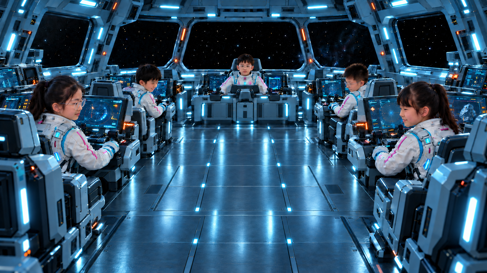
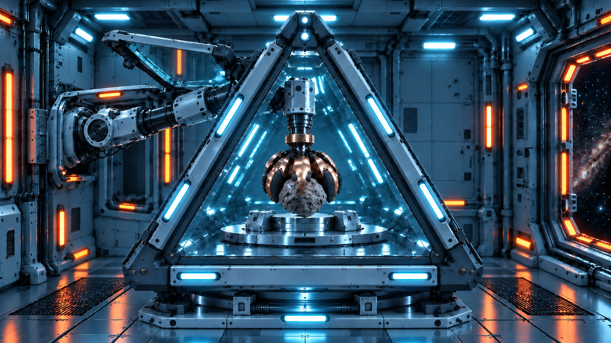
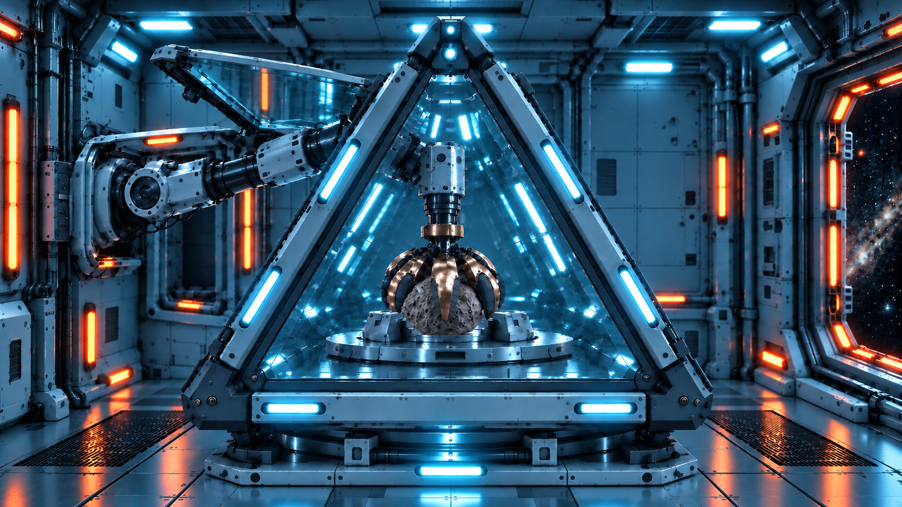
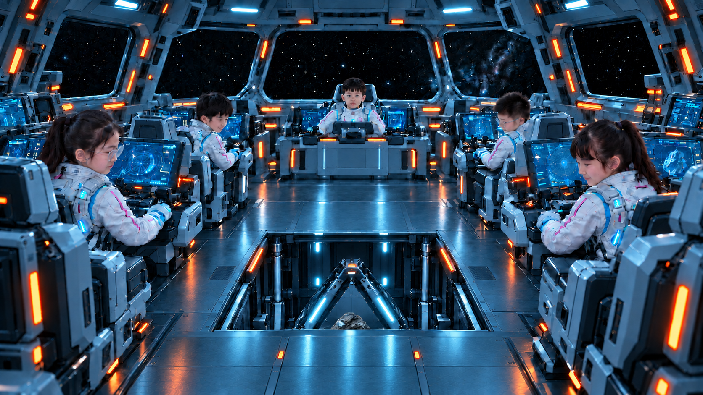
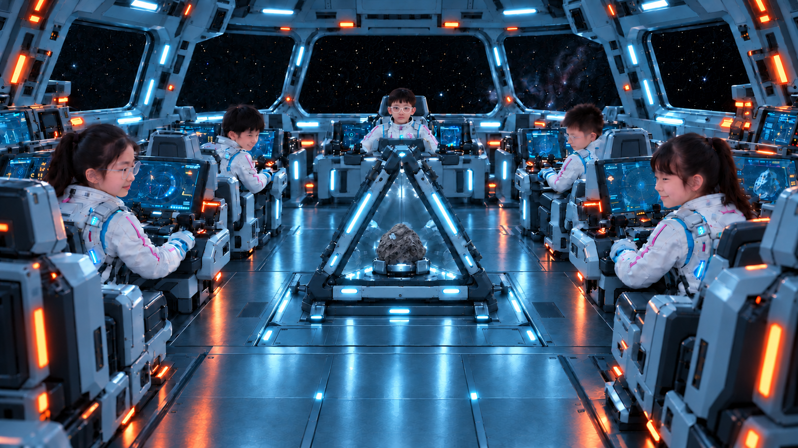

> 07D、07E最新选图已更新为[机械臂位于玻璃下方v2](07DE_机械臂玻璃避让_v2.md)。下列v1保留作历史记录。

# Cyan配色与玻璃侧门修正

本轮11张，内置imagegen编辑。颜色参考项目根目录 `Cyan-Orbital-Containment-Lab.png`：深蓝灰舱体、青蓝主照明、少量橙红指示灯；保留各帧构图、动作及人物。

07A、07B原有上掀矩形侧面改为透明玻璃，保留金属边框和铰接位置；07C—07F在相同位置补齐上掀玻璃侧面，机械臂从其下方开口进入，收臂后玻璃仍开启。08A以后侧门关闭，按各帧原有封闭/升舱状态处理。

底图说明：制作时目录内07A—09B仅剩Neon配色版，因此使用这些现存对应动作图作为底图；01使用用户指定v5。全部底图保留，新图另存。下表记录准确映射。

| 底图 | 当前Cyan版 |
|---|---|
| [01_五人舰桥正常工作_眼镜校正_v5.png](01_五人舰桥正常工作_眼镜校正_v5.png) | [01_五人舰桥正常工作_眼镜校正_v5_Cyan配色_v1.png](01_五人舰桥正常工作_眼镜校正_v5_Cyan配色_v1.png) |
| [07A_开口朝下_五瓣抓牢携石_石头统一_v6_Neon配色_v1.png](07A_开口朝下_五瓣抓牢携石_石头统一_v6_Neon配色_v1.png) | [07A_开口朝下_五瓣抓牢携石_石头统一_v6_Cyan配色_玻璃侧门_v1.png](07A_开口朝下_五瓣抓牢携石_石头统一_v6_Cyan配色_玻璃侧门_v1.png) |
| [07B_开口朝下_落座仍抓牢_石头统一_v6_Neon配色_v1.png](07B_开口朝下_落座仍抓牢_石头统一_v6_Neon配色_v1.png) | [07B_开口朝下_落座仍抓牢_石头统一_v6_Cyan配色_玻璃侧门_v1.png](07B_开口朝下_落座仍抓牢_石头统一_v6_Cyan配色_玻璃侧门_v1.png) |
| [07C_刚性连接_五瓣松开未抬臂_石头统一_v6_Neon配色_v1.png](07C_刚性连接_五瓣松开未抬臂_石头统一_v6_Neon配色_v1.png) | [07C_刚性连接_五瓣松开未抬臂_石头统一_v6_Cyan配色_玻璃侧门_v1.png](07C_刚性连接_五瓣松开未抬臂_石头统一_v6_Cyan配色_玻璃侧门_v1.png) |
| [07D_刚性连接_张瓣抬起空抓手_石头统一_v3_Neon配色_v1.png](07D_刚性连接_张瓣抬起空抓手_石头统一_v3_Neon配色_v1.png) | [07D_刚性连接_张瓣抬起空抓手_石头统一_v3_Cyan配色_玻璃侧门_v1.png](07D_刚性连接_张瓣抬起空抓手_石头统一_v3_Cyan配色_玻璃侧门_v1.png) |
| [07E_刚性连接_抬起后五瓣闭合_石头统一_v3_Neon配色_v1.png](07E_刚性连接_抬起后五瓣闭合_石头统一_v3_Neon配色_v1.png) | [07E_刚性连接_抬起后五瓣闭合_石头统一_v3_Cyan配色_玻璃侧门_v1.png](07E_刚性连接_抬起后五瓣闭合_石头统一_v3_Cyan配色_玻璃侧门_v1.png) |
| [07F_开口朝下_闭瓣空臂收回_v1_Neon配色_v1.png](07F_开口朝下_闭瓣空臂收回_v1_Neon配色_v1.png) | [07F_开口朝下_闭瓣空臂收回_v1_Cyan配色_玻璃侧门_v1.png](07F_开口朝下_闭瓣空臂收回_v1_Cyan配色_玻璃侧门_v1.png) |
| [08A_机械臂收拢_回收舱盖关闭_石头统一_v2_Neon配色_v1.png](08A_机械臂收拢_回收舱盖关闭_石头统一_v2_Neon配色_v1.png) | [08A_机械臂收拢_回收舱盖关闭_石头统一_v2_Cyan配色_v1.png](08A_机械臂收拢_回收舱盖关闭_石头统一_v2_Cyan配色_v1.png) |
| [08B_同舱封闭_外舱门锁止_石头统一_v2_Neon配色_v1.png](08B_同舱封闭_外舱门锁止_石头统一_v2_Neon配色_v1.png) | [08B_同舱封闭_外舱门锁止_石头统一_v2_Cyan配色_v1.png](08B_同舱封闭_外舱门锁止_石头统一_v2_Cyan配色_v1.png) |
| [09A_升舱起态_中央眼镜校正_石头统一_v3_Neon配色_v1.png](09A_升舱起态_中央眼镜校正_石头统一_v3_Neon配色_v1.png) | [09A_升舱起态_中央眼镜校正_石头统一_v3_Cyan配色_v1.png](09A_升舱起态_中央眼镜校正_石头统一_v3_Cyan配色_v1.png) |
| [09B_升舱终态_中央眼镜校正_石头统一_v3_Neon配色_v1.png](09B_升舱终态_中央眼镜校正_石头统一_v3_Neon配色_v1.png) | [09B_升舱终态_中央眼镜校正_石头统一_v3_Cyan配色_v1.png](09B_升舱终态_中央眼镜校正_石头统一_v3_Cyan配色_v1.png) |

## 预览

### 01_

### 07A

### 07B

### 07C

### 07D

### 07E

### 07F

### 08A

### 08B

### 09A

### 09B

[提示词与制作记录](Cyan配色与玻璃侧门_制作记录_2026-11-01.json)

