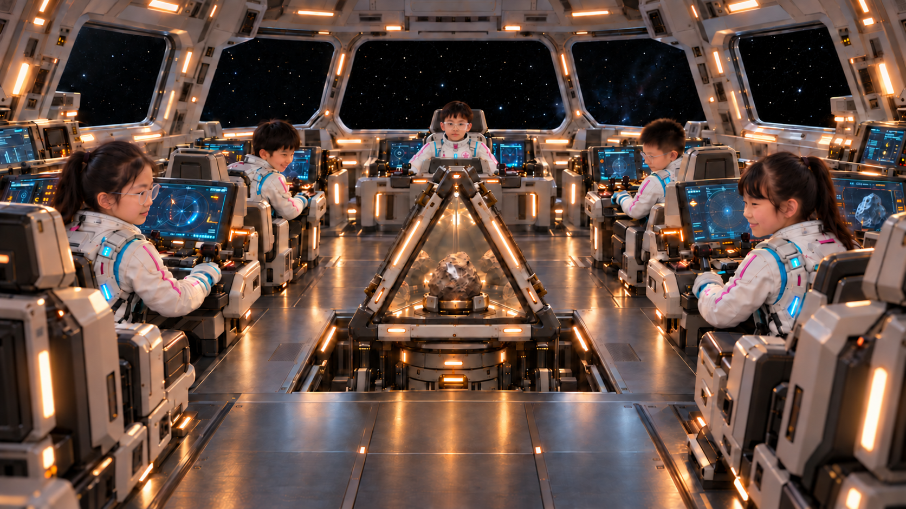
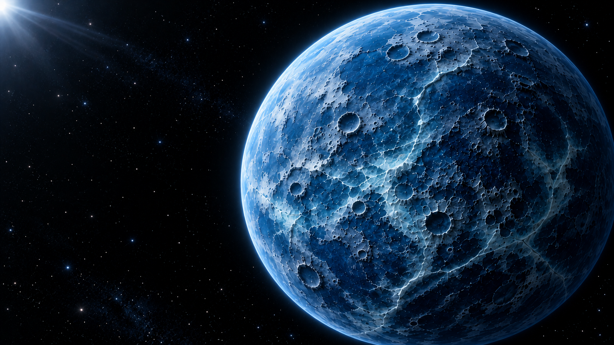
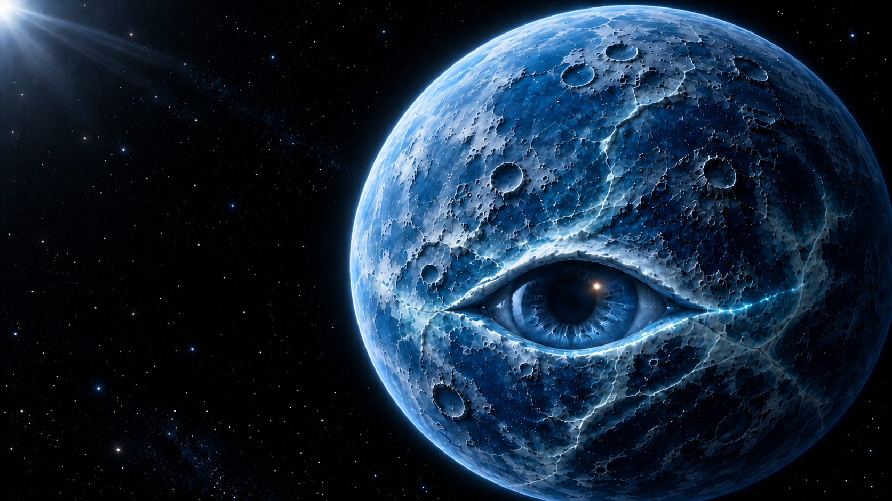
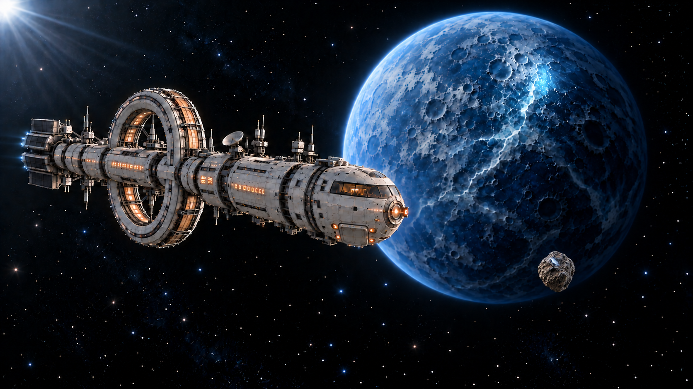

# 七组标准画面补齐索引

2026-10-31。对应《标准画面缺口检查》“尚需补齐的7组画面”。使用内置imagegen，当前选用11张单幅画面，覆盖7组。另存的早期版本保留，不覆盖或删除已有文件。

人物以原照片及最新C-v5身份校正为基础，后排中央男孩的透明眼镜在本轮最终舰桥图中再次局部补强。左壁臂座、中央回收舱与升降平台、右侧外舱门、上方舰桥共用楼板沿用ship横切面。新交接图使用真实舱内机位，不显示剖开的外壳。

## 1. 五人观看上升的回收舱

当前选图：`C_回收舱升起观看_眼镜校正_v6.png`。沿用C-v5的女生身份、中央男孩正向小头比例、原座位与自然观看姿态；只补强中央透明眼镜。四侧人物自然向内，中央男孩头部保持正向、目光朝前景样本，不强行低头或前倾。

## 2. 下层采样舱内交接

`07A`：机械臂已携石收回同一下层室内，石头仍在抓手中，中央托座为空。完整三角前窗保持固定，装载口在其后方斜面；腕部随末端小臂同轴，接近位置由肩肘调整。

`07B`：唯一石头固定在托座，抓手已张开退出。镜面里的石头为倒影。两个状态间的视频仍须依次完成送入、托座夹稳再松手，不可用跳切让样本瞬移。

## 3. 收臂、封装与关闭外舱门

`08A`：机械臂收拢在同一下层舱左侧，空抓手避开升降通路，回收舱盖已关闭；右侧外舱门仍开。

`08B`：只关闭右侧外舱门，其余机位、舱体、机械臂、样本状态一致。完成这一步之后才能打开舰桥地板。

## 4. 结尾普通态与睁眼态

`06A→06B`：以普通态局部编辑睁眼态，保留球体轮廓、主要陨坑、光线和空轨道。普通态没有眼缝，睁眼只用于最后反转。空处没有石头或飞船。视频阶段加入蓝光寻找与等待，不能把静态图当作已经完成的睁眼动画。

## 5. 正常任务状态舰桥

地板关闭、中央通道无回收舱，五人、三副眼镜及原服装保持连续，屏幕面朝操作者。使用本v5；本轮较早的01-v3与身份校正v4仅作过程稿。

## 6. 石头反光与矮行星的关系

沿用最新03C-v2的正常球形矮行星、新船型和唯一前景石头。蓝色亮点来自矿物面反射，匹配远处表面蓝色微光，没有眼形地貌或实体激光柱。前景石头的大画面占比来自透视，实体仍约25厘米。

## 7. 升舱起止状态

顺序为：08B外舱门关闭→01地板关闭→09A地板打开→C-v6升起中→09B平台到位。01作为关闭状态的场景基准，不必在成片中重复出现整段。

`09A-v2`：地板已打开，三角回收舱仍低于地板，井内为封闭室内空间。人物身份和眼镜以校正版为准。

`09B-v2`：平台对接到位，升降口由平台承接，回收舱固定，四周没有敞开的深井。保留五人身份、原头部比例与自然观看姿态。

## 生成与验收记录

- 当前采用11张图，所有文件均在本目录。提示词及参考顺序见 `../提示词/七组补齐/`；生成清单包含原始输出路径与版本。
- 本轮07A初稿将三角前窗截成梯形，已通过imagegen纠正后才保存为当前图；生成记录包含纠正提示词。
- 正常舰桥、升舱起态、中间态及终态均补强中央眼镜，避免人物特征在动作间消失。远景无法替代原人物身份照片，人物近景仍须使用对应原图。
- 动态视频另需检查五瓣数量、关节刚性、腕部姿态、交接接触、镜面反射与时序。标准静帧补齐不表示视频已生成。
- 本轮生成15个保存版本，其中11张为当前选图，4张为本轮比较稿。原先已有文件均保留。
