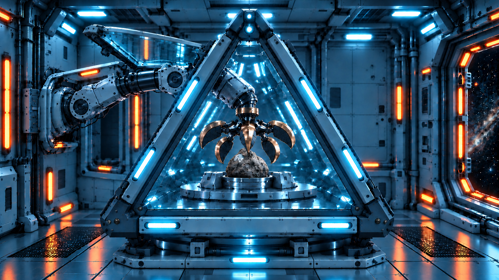
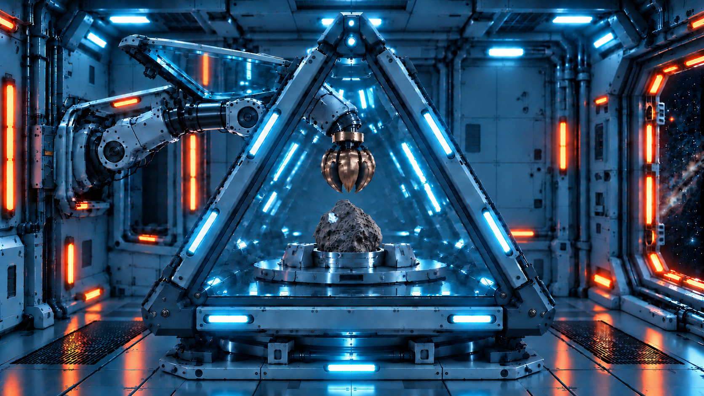
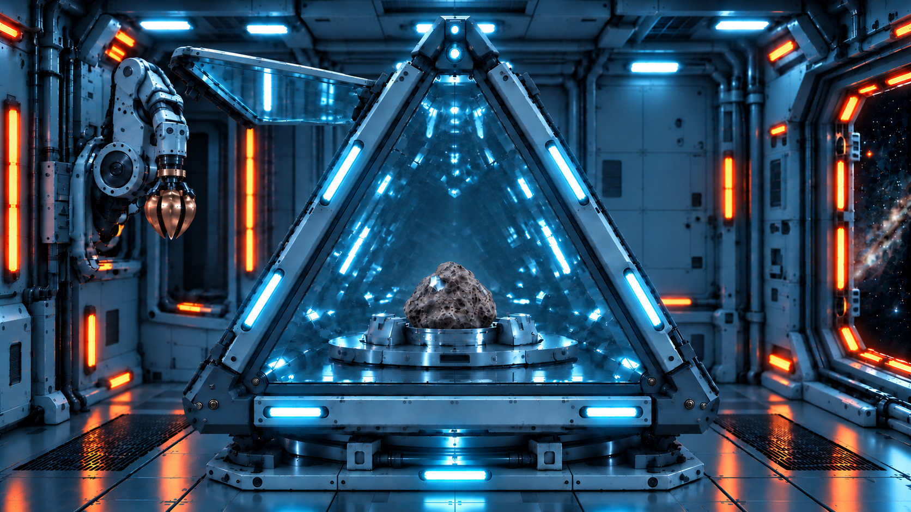
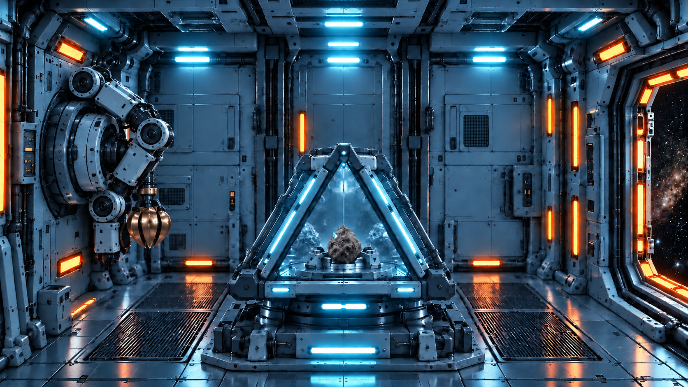
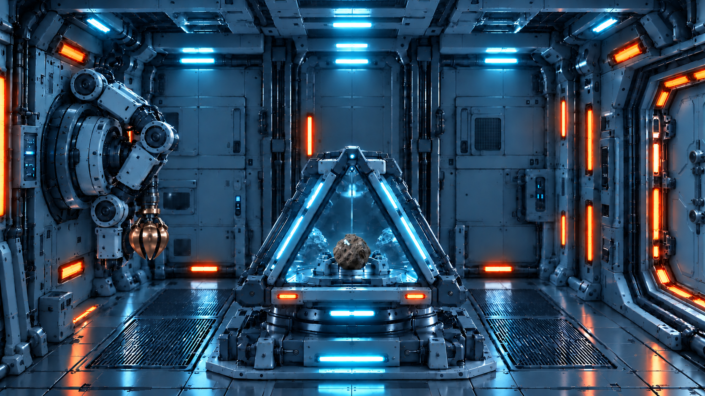

# 石头、遮挡与闭合抓手修订预览

本轮内置imagegen生成6张，保留所有底图。石头以原08A Cyan v1为参考，闭合抓手以原07F Cyan玻璃侧门v1为参考。

已调整：07C/07D中央金色花瓣位于石头前方并形成遮挡；07E/08A/08B闭合抓手采用07F的紧凑花苞形；07C—07F石头以08A为统一参考重绘。

验收限制：生成结果仍存在石头轮廓、纹理和尺度的细小差异，尚未满足用户要求的“一模一样，不要有差异”。这些图片为修订预览，不应视为石头一致性的最终锁定版本。要获得完全一致的样本，需将08A同一石头图像精确抠图并按各帧透视/遮挡合成，不能仅凭生成式重绘保证。抓手形状也为视觉参考匹配，并非同一三维资产的严格重投影。

## 07C

## 07D

## 07E

## 07F

## 08A

## 08B

[提示词](石头与闭合抓手_修订提示词.txt)

