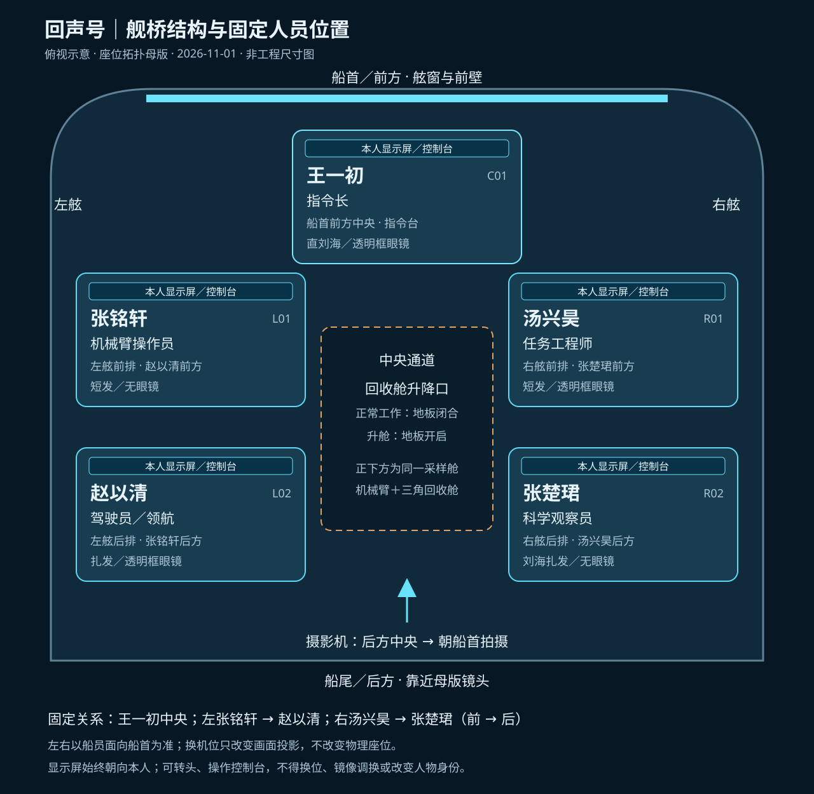

# 舰桥固定人员位置（唯一座位母版）

生效日期：2026-11-01。依据用户确认及 `标准画面/01_五人舰桥正常工作_五人各看显示屏_Cyan配色_v1.png`。本文件与位置图优先于旧版座位表；后续所有图片、视频、提示词、正反打均严格遵守。

[打开详细位置图](舰桥结构与固定人员位置_v1.svg)

## 坐标与摄影机

船首／舷窗方向为前，船尾／母版摄影机方向为后。左右定义为船员面向船首时的左舷、右舷。母版摄影机在舰桥后方中央，朝船首拍摄：画面左侧对应左舷，右侧对应右舷。不能继续使用旧标准“前方朝后拍”的描述。位置图只固定相对布局，不代表测量尺寸或全部设备朝向的工程图。

| 席位编号 | 人物 | 岗位 | 物理位置 | 母版画面位置 | 身份识别 |
|---|---|---|---|---|---|
| C01 | 王一初 | 指令长 | 前方中央指令台 | 远处中央 | 直刘海，透明框眼镜 |
| L01 | 张铭轩 | 机械臂操作员 | 左舷前排 | 左侧中景、较远 | 短发，无眼镜 |
| L02 | 赵以清 | 驾驶员／领航 | 左舷后排，张铭轩后面 | 最左前景、靠近镜头 | 扎发，透明框眼镜 |
| R01 | 汤兴昊 | 任务工程师 | 右舷前排 | 右侧中景、较远 | 短发，透明框眼镜 |
| R02 | 张楚珺 | 科学观察员 | 右舷后排，汤兴昊后面 | 右侧前景、靠近镜头 | 刘海扎发，无眼镜 |

## 结构与操作约束

中央指令台在五席前方中央，两侧各有前后两席，座椅与实体控制台固定。各显示屏在对应操作者前方，显示面朝本人。中央通道保持畅通，回收舱升降口位于两列席位之间；正常工作时地板闭合。正下方仍为一个封闭采样舱，机械臂和三角回收舱同处其内；外舱门关闭后才开舰桥地板升舱。此图不另行更改采样舱结构母版。

## 后续生成固定提示词

舰桥严格采用固定五席：船首先前，船员面向船首的左舷前排张铭轩、后排赵以清；右舷前排汤兴昊、后排张楚珺；前方中央指令台王一初。后方朝前母版机位中，赵以清位于左前景，张铭轩位于左中景，张楚珺位于右前景，汤兴昊位于右中景，王一初远处中央。人物身份、发型、眼镜、服装与席位一一锁定，镜头切换不得换位或镜像互换。人物可在自己的座位自然转头、看屏幕或操作，五人注视回收舱时也不改变座位。显示屏始终朝向各自操作者。

## 验收

每张新图先核对C01、L01/L02、R01/R02的物理关系，再核对五人脸、眼镜与服装；有冲突则修图，不以提示词声称一致代替目视检查。换机位时使用物理坐标，不能机械套用母版画面的左右前景位置。旧图保留，旧文字与本文件冲突时以本文件为准。现有其他画面不会因新增标准而自动视为已校正。

