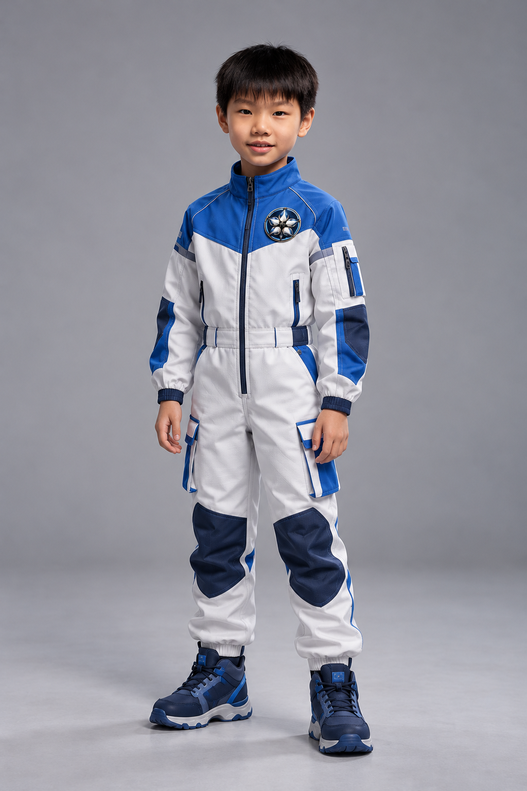
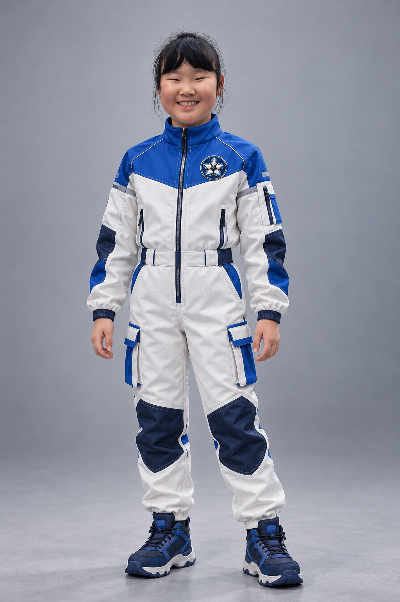
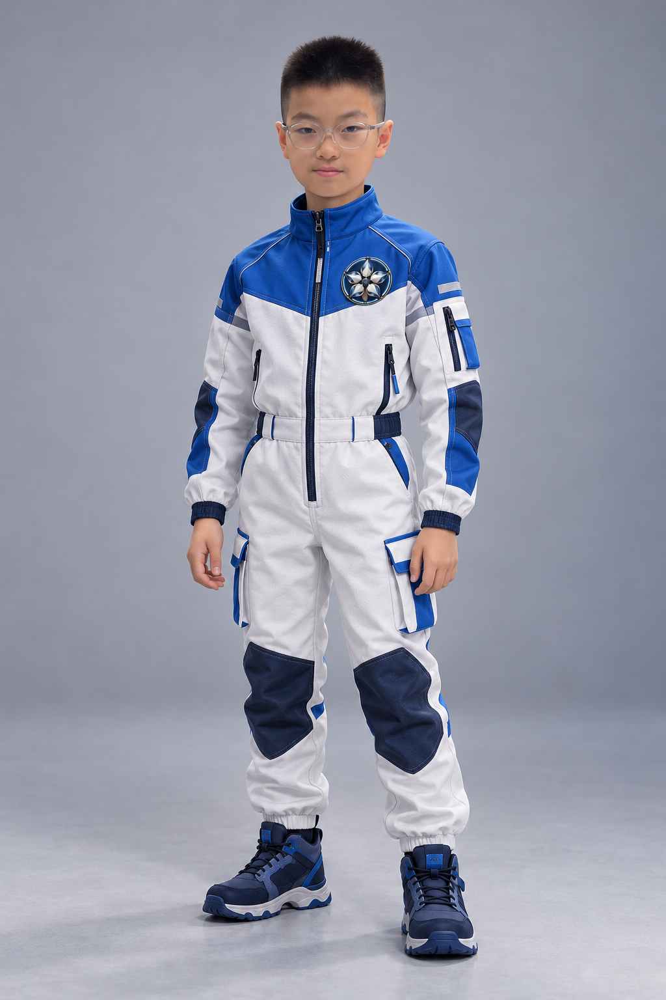
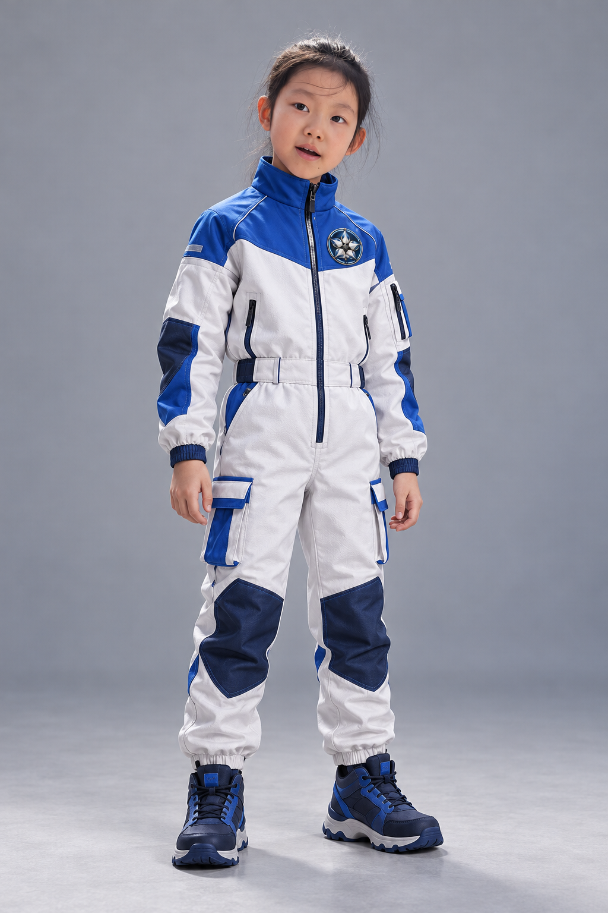
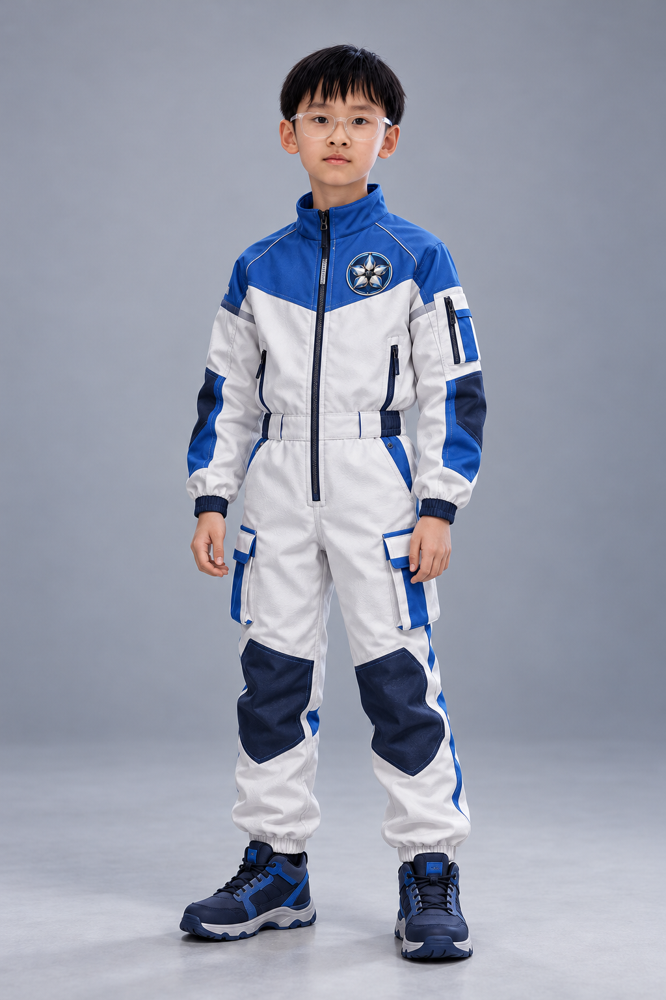

# 五人定妆照 · 第一版

制作日期：2026-10-29。使用 imagegen，原有照片与全部旧版效果图保留。

服装：第一轮 A 航天工装；队徽：第二轮 A 五瓣光圈，统一左胸。中性背景用于后续人物参考，背景不作为舰桥设计。

已检查：单人完整站姿、蓝白服装、左胸五瓣徽章；汤兴昊与王一初保留透明浅色眼镜，另外三人无眼镜。本人相似度待用户核对。徽章是生成重现，精细特写仍应附原徽章图约束，不视为逐像素复制。此版没有耳麦，后续如剧情需要应统一规定位置。

## 张铭轩

## 张楚珺

## 汤兴昊

## 赵以清

## 王一初

## 低分辨率试片建议

MiniMax-H3-Max，480P，16:9，先做两条各8–10秒的外景与舱内操作试片，检查大船尺度、镜头运动、光影、真人表演和实际操作细节。通过后同模型768P正式制作。480P不用于最终判断徽章、肤质与手指细节。

官方规格：Max为极速生成版本，480P/768P，5–15秒；Lite为轻量版本，480P/768P，4–15秒；Max名称不等于最高画质。标准H3支持768P/2K。

来源：[MiniMax视频V2官方文档](https://platform.minimax.cn/docs/api-reference/video-generation-v2-create)。本轮未提交视频任务。
