# 《去看一眼》定妆照与道具参考图

由内置imagegen生成，16张当前选用图；另保留3张迭代初稿。未生成视频或童声。人物为基于本人照片的合成定妆图，请最终核对相似度。所有生成提示词与来源保存在 [imagegen生成记录.json](imagegen生成记录.json)。

| 素材 | 当前文件 | 说明 |
|---|---|---|
| 张铭轩 | [张铭轩.png](refs/张铭轩.png) | 指令长；身份参考1/2 |
| 张楚珺 | [张楚珺.png](refs/张楚珺.png) | 驾驶员；身份参考1/3 |
| 汤兴昊 | [汤兴昊.png](refs/汤兴昊.png) | 机械臂手；身份参考1/3，保留浅框眼镜 |
| 赵以清 | [赵以清.png](refs/赵以清.png) | 科学官；参考1中的红衣女孩及参考3 |
| 王一初 | [王一初.png](refs/王一初.png) | 通讯员；身份参考1/4，保留浅框眼镜 |
| 观察舱 | [cabin.png](refs/cabin.png) | 圆窗、圆柱舱壁、五个工作岗位 |
| 回声号 | [ship.png](refs/ship.png) | 旧白灰圆柱船体、环状结构、前端圆窗 |
| 五瓣抓手 | [arm.png](refs/arm.png) | 五个独立瓣叶、铰链、软接触垫 |
| 近石 | [rock.png](refs/rock.png) | 同一灰褐岩块及右上反光面 |
| 三角样本舱 | [chamber-v2.png](refs/chamber-v2.png) | 已修正为可打开的透明门与通畅入口 |
| 伴体闭合 | [companion_closed.png](refs/companion_closed.png) | 岩石、两主坑和闭合山脊 |
| 伴体睁开 | [companion_open-v2.png](refs/companion_open-v2.png) | 同一岩体的低对比玻璃眼，无恐怖血肉 |
| 机械岗位 | [汤兴昊_station-v2.png](refs/汤兴昊_station-v2.png) | 操纵杆和控制台，已移除冲突的二指机械臂 |
| 木星 | [jupiter.png](refs/jupiter.png) | 引力辅助途中背景 |
| 空间关系 | [world_wide.png](refs/world_wide.png) | 矮行星左后、近石左下、伴体右上；非精确尺度图 |
| 开场星光 | [world_star.png](refs/world_star.png) | 近黑星场与右上微光 |

## 五位成员

### 张铭轩

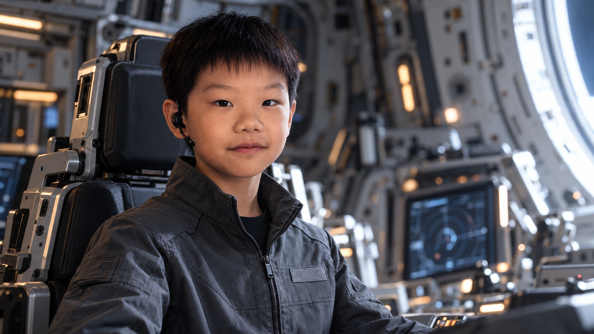

### 张楚珺

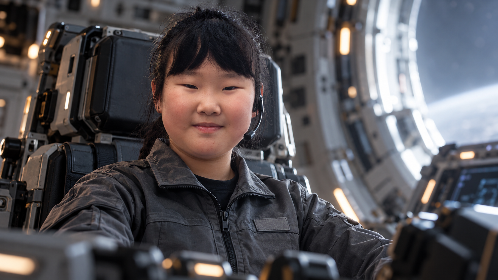

### 汤兴昊

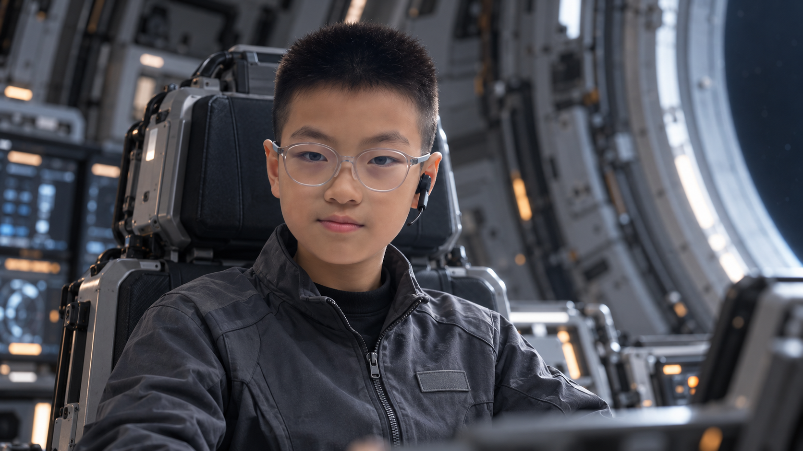

### 赵以清

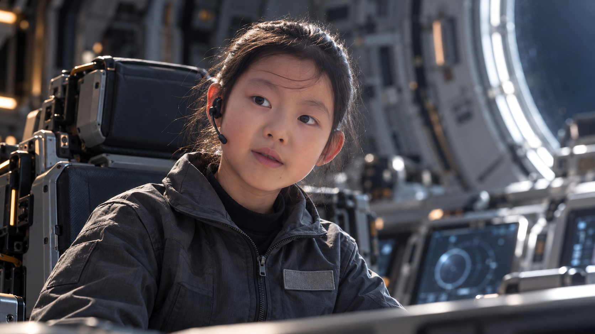

### 王一初

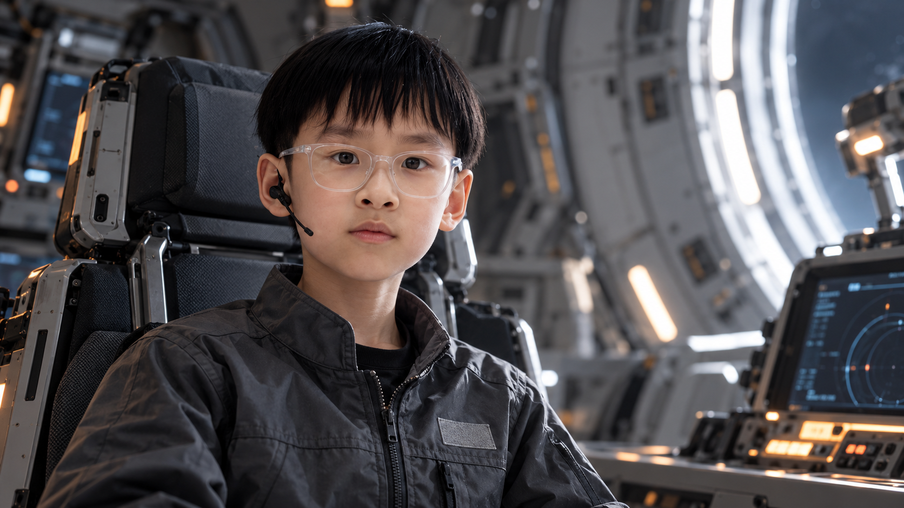

## 道具与场景

### 观察舱

圆窗、圆柱舱壁、五个工作岗位。

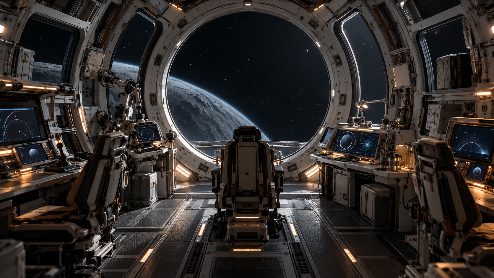

### 回声号

旧白灰圆柱船体、环状结构、前端圆窗。

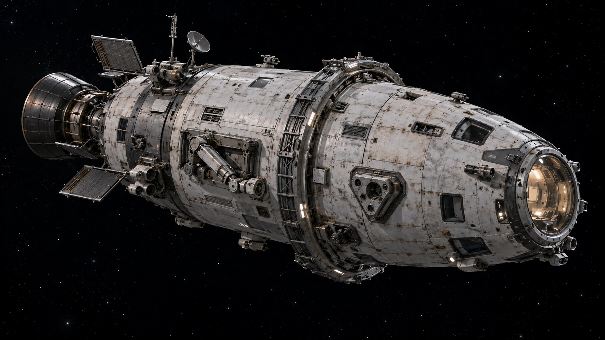

### 五瓣抓手

五个独立瓣叶、铰链、软接触垫。

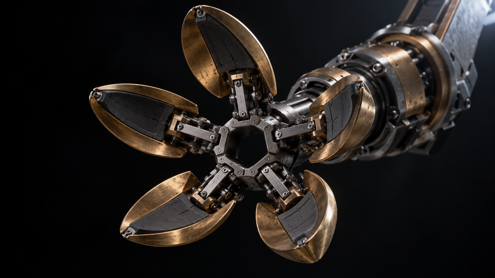

### 近石

同一灰褐岩块及右上反光面。

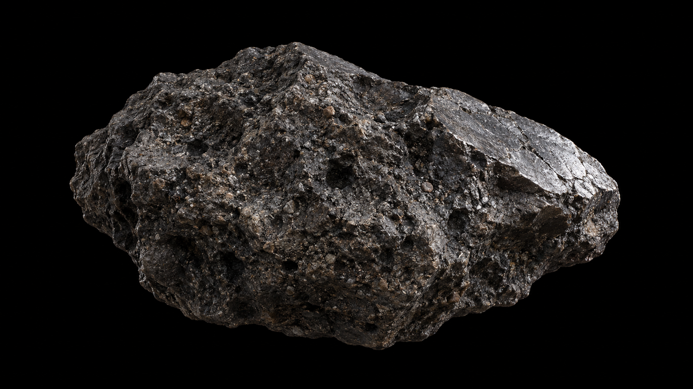

### 三角样本舱

已修正为可打开的透明门与通畅入口。

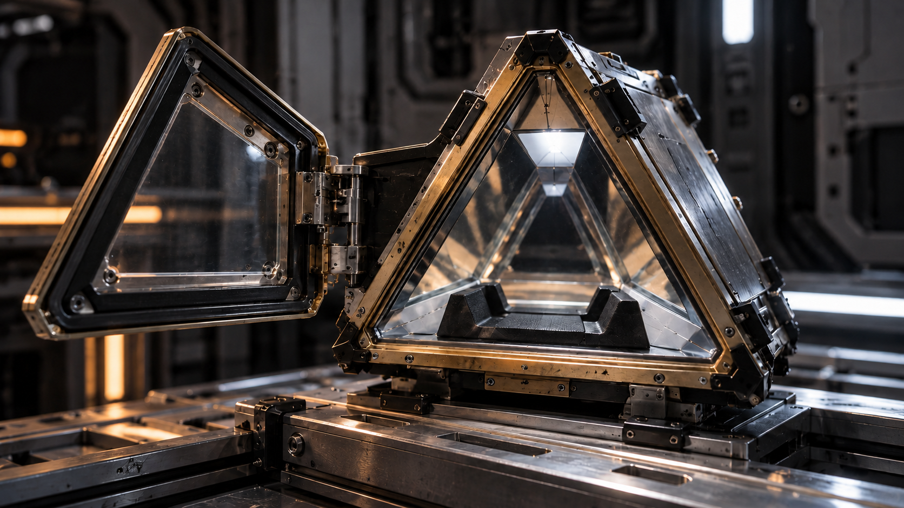

### 伴体闭合

岩石、两主坑和闭合山脊。

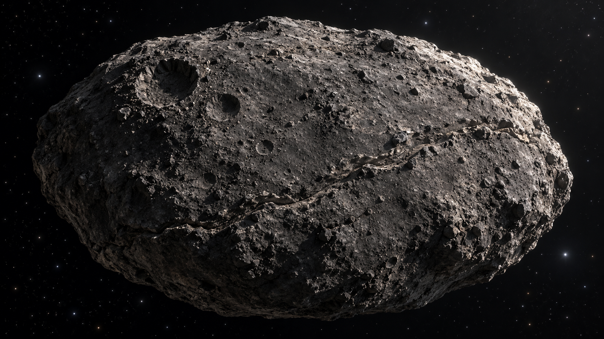

### 伴体睁开

同一岩体的低对比玻璃眼，无恐怖血肉。

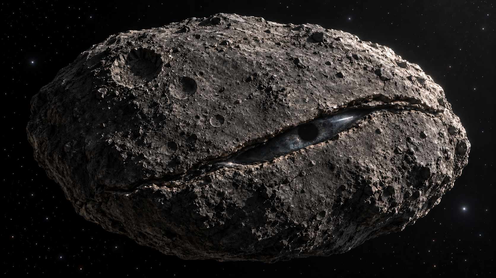

### 机械岗位

操纵杆和控制台，已移除冲突的二指机械臂。

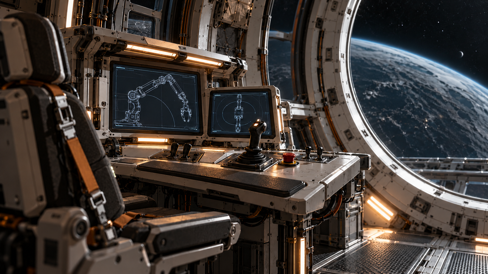

### 木星

引力辅助途中背景。

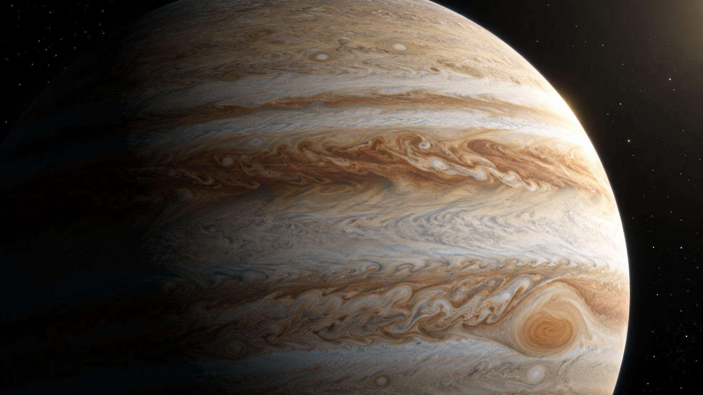

### 空间关系

矮行星左后、近石左下、伴体右上；非精确尺度图。

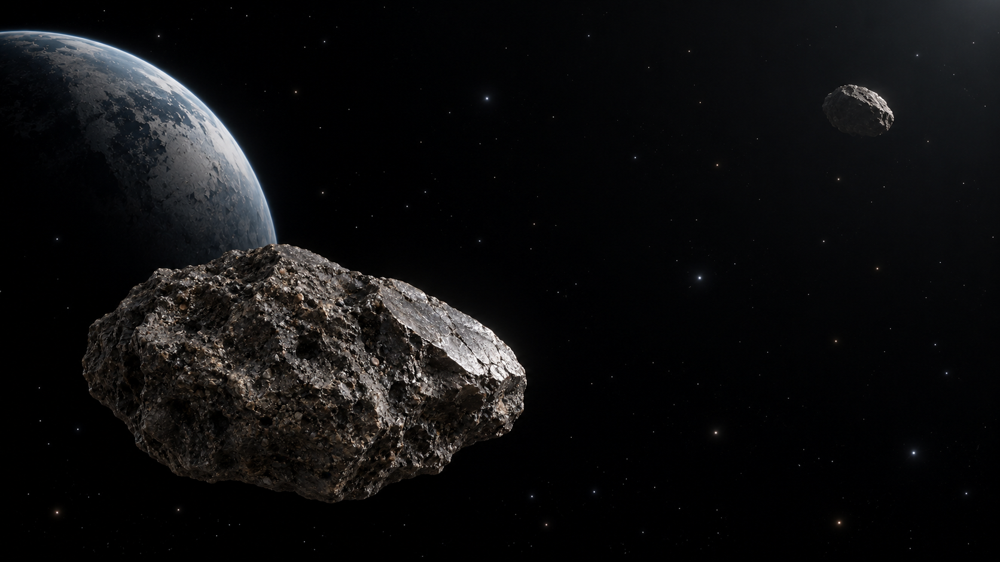

### 开场星光

近黑星场与右上微光。

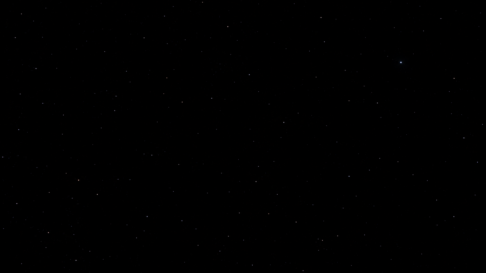

## 检查说明

已检查五瓣数目、人物眼镜、单人画面、统一服装、闭合/睁开轮廓及采样入口。样本舱与伴体曾迭代，旧版不作当前视频参考。图像是视觉设计参考，不能替代机械工程与轨道计算。全景中近石的画面占比高于远景镜头需求，视频应按提示词调整景别。未把AI图当作真人实拍。
